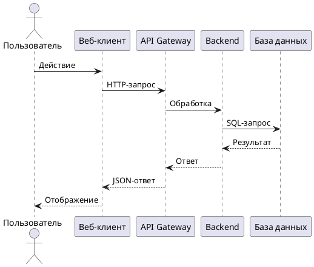

# Functional Requirements Document (FR)

<!--
  Заполни: название фичи (рус.)
  Ссылки на ADR и BRD обязательны.
  FR отвечает на вопрос «что», ADR — на вопрос «как».
-->

## Фича: <Название фичи>

**Дата:** <!-- Дата создания -->
**Версия:** 1.0
**Статус:** Черновик

**Основание:** Документ разработан на основе [ADR](02-ADR.md) и [BRD](01-BRD.md) (ADR v1.0, BRD v1.0).

---

## 1. Функциональные требования

<!--
  User Story от трёх лиц:
  - Пользователь сайта
  - Администратор в панели управления
  - Backend-сервис (системные интеграции)
-->

| ID | Как | Я хочу | Чтобы | Критерий приёмки |
|---|---|---|---|---|
| FR-01 | <!-- роль --> | <!-- действие --> | <!-- результат --> | <!-- условие --> |
| FR-02 | <!-- роль --> | <!-- действие --> | <!-- результат --> | <!-- условие --> |

---

## 2. Модель данных

<!--
В названии всех объектов (базы данных, схемы, индексы, вью, столбцы, триггеры и т.д.) ДОЛЖНЫ использоваться только латинские символы в нижнем регистре, цифры и нижнее подчеркивание
Название объекта ДОЛЖНО начинаться с буквы в нижнем регистре
В качестве кодировки необходимо использовать UTF8
РЕКОМЕНДУЕТСЯ организовывать аутентификацию таким образом чтобы каждое приложение/сервис имело своего собственного пользователя
Обязтельные поля, необходимые для описания любой БД:
| Поле | Тип | Nullable | Описание |
|---|---|---|---|
| id | int | Нет | Идентификатор записи |
| created_at | timestamp | Да | Дата создания |
| updated_at | timestamp | Да | Дата обновления |

Используй всегда эти типы данных и никакие больше:
int - целочисленные значение;
number - числа с плавающей точкой;
string - строковые значения;
boolean - булевые значения (да/нет);
timestamp - значения дат.

-->

### Сущность: <Название>

| Поле | Тип | Nullable | Описание |
|---|---|---|---|
| `id` | int | Нет | Идентификатор записи |
| <!-- поле --> | <!-- тип --> | <!-- да/нет --> | <!-- описание --> |

**Связи:**

<!--
  Например: "User имеет Collection User → Role (многие-ко-многим через user_role_links)"
-->

---

## 3. API-спецификация

<!--
  Для каждого публичного эндпоинта: метод, URL, request, response.
  Используй RESTful-стиль.

  API эндпоинты описываются только для публичной части сайта! Для админ панели этого делать не нужно!
  Не описывай админские API-эндпоинты: для админ-панели достаточно раздела 4.

Для реализации API используется архитектурный стиль REST.
Форматом передачи данных ДОЛЖЕН быть json.
Название ресурса в эндпоинте ДОЛЖНО быть во множественном числе (POST /v1/users, а не POST /v1/user), за исключением тех случаев когда ресурс может существовать только в единственном числе (/v1/profile).
Название ресурса в эндпоинте ДОЛЖНО быть в kebab-case.
Параметры в query и поля в body ДОЛЖНЫ быть в snake_case.
Идентификатор версии API всегда ДОЛЖЕН присутствовать в урле, например POST /v1/users.
Несуществующие страницы API ДОЛЖНЫ отдавать 404 ошибку и json ответ соответствующий формату описанному в разделе “Формат ответа” c code: "NotFoundHttpException".
Формат полей
Все целочисленные идентификаторы сущностей ДОЛЖНЫ иметь тип integer.
Datetime поля должны передаваться строкой в формате ISO-8601 в UTC. Например “updated\_at”: “2020-01-01T15:47:21.000000Z” В описании такое поле описывается как type: string, format: date-time.
Даты (без времени) должны передаваться строкой в формате ISO-8601 full date. Например “birhtday”: “1990-01-25” В описании такое поле описывается как type: string, format: date.
Цены должны передаваться в копейках, с типом integer.
Формат ответа
Тело ответа ДОЛЖНО содержать только следующие поля:

data - основной объект ответа, может иметь следующие типы:

null;
object - в случае, если запрашивается одна сущность, например, запрос по id;
array - в случае, если запрашивается список сущностей, каждый элемент массива представляет собой отдельную конкретную сущность.
errors - необязательный массив ошибок запроса, каждый элемент в массиве содержит:

code - обязательный строковый код ошибки, скорее всего берется из фиксированного списка. В документации к api ДОЛЖЕН присутствовать enum, в котором перечислены все коды ошибок;
message - обязательное строковое описание ошибки;
meta - опциональный объект с дополнительными метаданными ошибки.
meta - необязательный объект с дополнительной информацией о запросе, например для передачи отладочной информации или информации для пагинации. Каждый компонент, который хочет добавить данные в этот объект, должен добавлять их через дополнительное поле, например: meta.pagination.* В корень объекта meta нельзя добавлять информацию для исключения конфликта в названии данных разных компонентов.

Список стандартных эндпоинтов:
Get	GET <resource-url>/<id>	Получение объекта по id
Create	POST <resource-url>	Создание объекта
Replace	PUT <resource-url>/<id>	Обновление всех полей объекта
Patch	PATCH <resource-url>/<id>	Обновление указанных полей объекта
Delete	DELETE <resource-url>/<id>	Удаление объекта
Search	POST <resource-url>:search	Поиск объектов по фильтрам
SearchOne POST <resource-url>:search-one	Быстрый поиск одного объекта по фильтру

Типы данных в API должны быть следующие: 
int - целочисленные значение;
number - числа с плавающей точкой;
string - строковые значения;
boolean - булевые значения (да/нет);
timestamp - значения дат.
-->

### <Метод> <URL>

**Параметры запроса:**

| Поле | Тип | Nullable | Описание |
|---|---|---|---|
| `id` | int | Нет | Идентификатор записи |
| <!-- поле --> | <!-- тип --> | <!-- да/нет --> | <!-- описание --> |

**Пример запроса:**

```json
{
  "field": "value"
}
```

**Параметры ответа:**

| Поле | Тип | Nullable | Описание |
|---|---|---|---|
| `id` | int | Нет | Идентификатор записи |
| <!-- поле --> | <!-- тип --> | <!-- да/нет --> | <!-- описание --> |


**Пример ответа:**

```json
{
  "id": 1,
  "status": "success"
}
```

**Пример ошибки**

```json
{

}
```

---

## 4. Админ-панель

<!--
  Список основных элементов админ. панели:
  1. Табличный список - основная информация о выбранной сущности - перечисление хранящихся полей. Возможна фильтрация полей. Возможность фильтрации указывается в таблице с описанием табличного списка (столбец "Фильтрация"). Возможна сортировка. Возможность сортировки указывается в таблице с описанием табличного списка (столбец "Сортировка"). Сортировка по-умолчанию указывается по "id" от большего к меньшему
  2. Детальная страница - детальная страница конкретной записи из выбранной сущности. Редактирования данных типа "id", "Дата создания" и "Дата обновления" невозможна всегда, т.к. это техническое поле, заполняемое автоматически.
-->

### Экран: Табличный список 

| Поле | Поле в БД | Фильтрация | Обязательность | Сортировка |
|---|---|---|---|---|
| <!-- Поле в админке --> | <!-- Название поля из БД --> | <!-- Да/Нет --> | <!-- Да/Нет --> | <!-- Да/Нет --> |

### Экран: Детальная страница 

| Поле | Поле в БД | Редактируемость | Обязательность |
|---|---|---|---|
| <!-- Поле в админке --> | <!-- Название поля из БД --> | <!-- Да/Нет --> | <!-- Да/Нет --> |

### Действия и права доступа

| Действие | Кто может | Ограничения |
|---|---|---|
| Просмотр списка | <!-- Роль или право --> | <!-- Ограничения --> |
| Создание | <!-- Роль или право --> | <!-- Ограничения --> |
| Редактирование | <!-- Роль или право --> | <!-- Ограничения --> |
| Удаление | <!-- Роль или право --> | <!-- Ограничения --> |

---

## 5. Sequence-диаграмма

<!--
  PlantUML-диаграмма основного бизнес-процесса.
  Диаграмма логическая: сервисы, хранилища и кеш берутся из ADR,
  новые архитектурные решения здесь не вводятся.
  Пример-заглушка ниже — замени на свою.
-->



---

## 6. Нефункциональные требования

<!--
  Производительность, безопасность, доступность, совместимость.
  Требования не должны противоречить ограничениям BRD и решениям ADR.
-->

| Категория | Требование |
|---|---|
| Производительность | <!-- Время отклика, RPS, ... --> |
| Безопасность | <!-- Аутентификация, авторизация, ... --> |
| Доступность | <!-- SLA, время простоя, ... --> |
| Совместимость | <!-- Браузеры, устройства, ... --> |

---

## 7. Матрица трассировки BR → FR

<!--
  Покажи, какие FR покрывают каждое BR.
-->

| BR ID | FR ID |
|---|---|
| BR-01 | FR-01, FR-02 |
| BR-02 | FR-03 |

---

## 8. Открытые вопросы

<!--
  Вопросы по FR, требующие уточнения.
-->

1. <!-- Вопрос -->
2. <!-- Вопрос -->

---

## 9. История изменений

<!--
  Каждое изменение согласованного документа — новая строка.
  1.1 — уточнения без изменения смысла, 2.0 — изменение требований.
  Если изменился ADR, здесь фиксируется, что FR пересмотрен.
-->

| Версия | Дата | Что изменилось |
|---|---|---|
| 1.0 | <!-- Дата --> | Первая версия |
