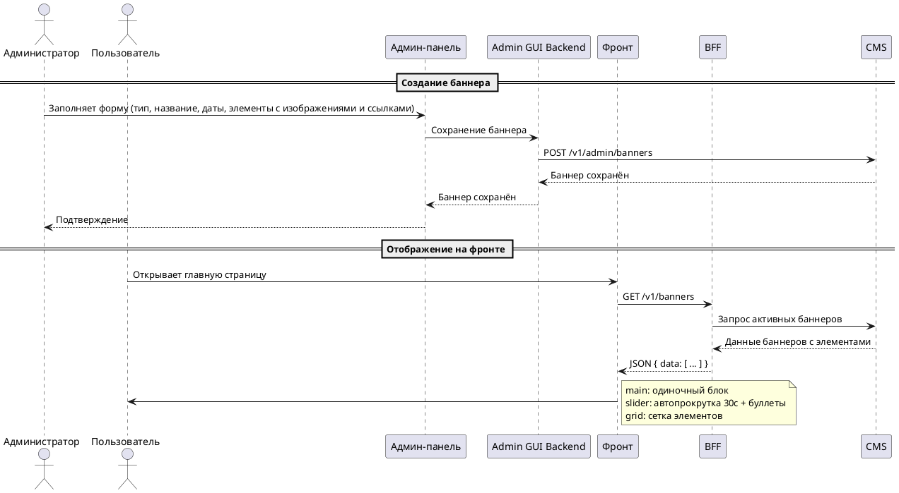

# Functional Requirements Document (FR)

## Фича: Управление баннерами

**Дата:** 03.11.2026
**Версия:** 1.3
**Статус:** Согласован

**Основание:** Документ разработан на основе [ADR](02-ADR.md) и [BRD](01-BRD.md) (ADR v1.3, BRD v1.3).

---

## 1. Функциональные требования

| ID | Роль | Я хочу | Чтобы | Критерий приёмки |
|---|---|---|---|---|
| FR-01 | Пользователь сайта | видеть активные баннеры на главной странице | ознакомиться с акциями и информацией | Баннер отображается, только если текущая дата входит в диапазон активности |
| FR-02 | Пользователь сайта | кликнуть на баннер | перейти по указанной ссылке | Открывается URL баннера в новой вкладке |
| FR-03 | Администратор | создать баннер на детальной странице | задать название, тип, изображение(я), ссылку(и) и даты активности | Баннер сохранён, отображается в таблице и на фронте (при соответствии дат) |
| FR-04 | Администратор | выбрать тип баннера при создании | определить способ отображения: главный, слайдер или плитка | Тип сохраняется; форма динамически меняется под выбранный тип |
| FR-05 | Администратор | загрузить одно изображение со ссылкой для типа "главный" | задать контент главного баннера | Изображение и ссылка сохранены через элемент баннера |
| FR-06 | Администратор | загрузить несколько изображений со ссылками для типа "слайдер" | сформировать набор слайдов | Добавлено 2+ элементов; порядок соответствует загрузке |
| FR-07 | Администратор | загрузить несколько изображений со ссылками для типа "плитка" | сформировать набор плиток | Добавлено 1+ элементов; порядок соответствует загрузке |
| FR-08 | Администратор | задать дату начала и окончания активности | запланировать показ баннера | Баннер виден на фронте только в указанном диапазоне |
| FR-09 | Администратор | просмотреть табличный список всех баннеров | управлять баннерами | Таблица содержит колонки: превью, название, тип, даты, статус |
| FR-10 | Администратор | отфильтровать список баннеров по типу, датам или статусу | быстро найти нужный баннер | Фильтры применяются, список обновляется |
| FR-11 | Администратор | отсортировать список баннеров по любой колонке | упорядочить данные | Сортировка работает по возрастанию/убыванию |
| FR-12 | Администратор | редактировать существующий баннер | изменить контент, тип, изображения, ссылки или даты | Изменения сохранены, фронт обновлён |
| FR-13 | Администратор | удалить баннер | убрать его с сайта и из системы | Баннер и его элементы полностью удалены |
| FR-14 | Администратор | управлять элементами внутри слайдера/плитки | добавлять, редактировать или удалять отдельные элементы | Элементы баннера обновляются независимо |
| FR-15 | Система | проверять даты активности при запросе баннеров | не показывать просроченные или будущие баннеры | API возвращает только баннеры с start_date <= now <= end_date |
| FR-16 | Система | отдавать баннеры с типом "слайдер" с параметрами автопрокрутки | фронт мог корректно отобразить навигацию | В ответе API для `slider` присутствует поле `autoplay_interval` (секунды) |
| FR-17 | Система | валидировать загружаемые изображения | принимать только JPEG/PNG до 25 МБ | Файлы других форматов или большего размера отклоняются |
| FR-18 | Система | запрещать публикацию второго активного баннера типа "главный" | на главной странице всегда отображался ровно один главный баннер | При сохранении второго активного main-баннера возвращается ошибка валидации |

---

## 2. Модель данных

### Сущность: `banners`

| Поле | Тип | Nullable | Описание |
|---|---|---|---|
| `id` | int | Нет | Идентификатор записи |
| `name` | string | Нет | Название баннера |
| `type` | string | Нет | Тип: `main`, `slider`, `grid` |
| `start_date` | timestamp | Нет | Дата начала показа |
| `end_date` | timestamp | Нет | Дата окончания показа |
| `created_at` | timestamp | Нет | Дата создания |
| `updated_at` | timestamp | Нет | Дата обновления |

**Связи:** `banners` имеет коллекцию `banner_image_links` (один-ко-многим). Все типы баннеров используют только элементы для хранения изображений и ссылок.

### Сущность: `banner_image_links`

| Поле | Тип | Nullable | Описание |
|---|---|---|---|
| `id` | int | Нет | Идентификатор записи |
| `banner_id` | int | Нет | Внешний ключ к `banners.id` |
| `image` | string | Нет | URL изображения |
| `link` | string | Нет | URL перехода |
| `sort_order` | int | Нет | Порядок отображения (соответствует порядку загрузки) |
| `created_at` | timestamp | Нет | Дата создания |
| `updated_at` | timestamp | Нет | Дата обновления |

**Связи:** `banner_image_links` → `banners` (многие-к-одному). Для типа `main` создаётся ровно одна запись, для `slider` — минимум две, для `grid` — минимум одна.

---

## 3. API-спецификация

### GET /v1/banners

Публичный эндпоинт. Возвращает активные баннеры для отображения на главной странице. Фильтрует по `start_date <= now <= end_date`.

**Параметры запроса:** нет

**Параметры ответа:**

| Поле | Тип | Nullable | Описание |
|---|---|---|---|
| `data` | array | Нет | Массив баннеров |
| `data[].autoplay_interval` | int | Да | Интервал автопрокрутки слайдера, сек (только для `type = slider`) |

**Пример ответа:**

```json
{
  "data": [
    {
      "id": 1,
      "name": "Новогодняя распродажа",
      "type": "main",
      "items": [
        {
          "id": 10,
          "image": "https://cdn.example.com/banners/new-year.jpg",
          "link": "https://example.com/sale"
        }
      ]
    },
    {
      "id": 2,
      "name": "Акции недели",
      "type": "slider",
      "autoplay_interval": 30,
      "items": [
        {
          "id": 20,
          "image": "https://cdn.example.com/banners/slide1.jpg",
          "link": "https://example.com/promo1"
        },
        {
          "id": 21,
          "image": "https://cdn.example.com/banners/slide2.jpg",
          "link": "https://example.com/promo2"
        }
      ]
    }
  ]
}
```

**Пример ошибки (БД недоступна):**

```json
{
  "errors": [
    {
      "code": "ServiceUnavailable",
      "message": "Сервис временно недоступен"
    }
  ]
}
```

---

## 4. Админ-панель

Все запросы админ-панели проходят через **Admin GUI Backend** — BFF админки, единую точку входа. Admin UI не обращается к CMS напрямую: BFF проксирует вызовы, проверяет аутентификацию и права администратора.

### Экран: Табличный список баннеров

| Поле в админке | Поле в БД | Фильтрация | Сортировка |
|---|---|---|---|
| ID | `id` | Нет | Да |
| Превью | `image` (первый элемент) | Нет | Нет |
| Название | `name` | Нет | Да |
| Тип | `type` | Да | Да |
| Дата начала | `start_date` | Да | Да |
| Дата окончания | `end_date` | Да | Да |
| Статус | вычисляется | Да (active/inactive) | Да |
| Кол-во элементов | вычисляется | Нет | Нет |
| Действия | — | Нет | Нет |

Доступные действия в строке таблицы: просмотр, редактирование, удаление.

### Экран: Детальная страница (создание/редактирование)

| Поле в админке | Поле в БД | Редактируемость | Обязательность |
|---|---|---|---|
| Название | `name` | Да | Да |
| Тип | `type` | Только при создании | Да |
| Дата начала | `start_date` | Да | Да |
| Дата окончания | `end_date` | Да | Да |
| Элементы | `banner_image_links` | Да | Да |

Форма элементов (изображение + ссылка) динамически меняется под тип:
- **main:** ровно одна пара полей "Изображение" и "Ссылка"
- **slider:** набор строк с полями "Изображение" и "Ссылка", минимум 2, можно добавлять/удалять строки
- **grid:** набор строк с полями "Изображение" и "Ссылка", минимум 1, можно добавлять/удалять строки

Кнопки: Сохранить, Отмена.

### Действия и права доступа

| Действие | Кто может | Ограничения |
|---|---|---|
| Просмотр списка и карточки | Администратор панели управления | Детализация ролей — открытый вопрос BRD, раздел 6 |
| Создание | Администратор панели управления | Обязательна валидация полей и изображений |
| Редактирование | Администратор панели управления | Тип баннера после создания не меняется |
| Удаление | Администратор панели управления | Требуется подтверждение удаления |

---

## 5. Sequence-диаграмма



---

## 6. Нефункциональные требования

| Категория | Требование |
|---|---|
| Производительность | API списка баннеров должен отвечать не более 500 мс при 1000 баннерах |
| Производительность | Главная страница с баннерами должна загружаться не более 2 секунд |
| Безопасность | Все административные операции требуют аутентификации и авторизации |
| Безопасность | Внешние ссылки открываются с `rel="nofollow noopener"` |
| Безопасность | Загружаемые изображения проверяются по MIME-типу (image/jpeg, image/png) |
| Доступность | Сервис баннеров должен быть доступен 99.5% времени |
| Совместимость | Фронт работает в Chrome, Firefox, Safari и Edge последних 2 версий |
| Совместимость | Админ-панель поддерживает десктопные браузеры (от 1280px) |

---

## 7. Матрица трассировки BR → FR

| BR ID | FR ID |
|---|---|
| BR-01 | FR-03 |
| BR-02 | FR-04, FR-18 |
| BR-03 | FR-05 |
| BR-04 | FR-06, FR-07 |
| BR-05 | FR-17 |
| BR-06 | FR-08 |
| BR-07 | FR-05, FR-06, FR-07 |
| BR-08 | FR-09 |
| BR-09 | FR-12, FR-14 |
| BR-10 | FR-13 |
| BR-11 | FR-01 |
| BR-12 | FR-01, FR-15, FR-18 |
| BR-13 | FR-02 |
| BR-14 | FR-10, FR-11 |
| BR-15 | FR-17 |
| BR-16 | FR-16 |

---

## 8. Открытые вопросы

_Все вопросы по FR закрыты:_

| Вопрос | Решение |
|---|---|
| Должен ли главный баннер быть только один активный одновременно? | Да, только один (FR-18). При сохранении второго активного `main`-баннера возвращается ошибка валидации |
| Нужно ли кеширование ответа `GET /v1/banners`? | Да, на уровне BFF, TTL 60 секунд с инвалидацией при изменении баннера (см. ADR-05) |
| Требуется ли предпросмотр баннера в админ-панели перед публикацией? | Нет, в текущем объёме не требуется |

---

## 9. История изменений

| Версия | Дата | Что изменилось |
|---|---|---|
| 1.3 | 03.11.2026 | В основании зафиксированы версии ADR (v1.3) и BRD (v1.3). В sequence-диаграмму добавлен Admin GUI Backend: админ-поток идёт через BFF админ-панели, а не напрямую в CMS. В разделе 4 добавлено пояснение о единой точке входа. Функциональные требования FR-01–FR-18 не менялись. Статус изменён на «Согласован» по подтверждению пользователя 06.11.2026, содержательных правок нет |
| 1.2 | 02.11.2026 | В основании зафиксированы версии ADR (v1.2) и BRD (v1.3). Изменение ADR — вынос схемы в отдельный файл, требования и решения не менялись, поэтому FR остаётся согласованным. Добавлен раздел «История изменений» |
| 1.1 | 01.11.2026 | Предыдущая согласованная версия (состав изменений до введения раздела не детализирован) |
| 1.0 | 01.11.2026 | Первая версия |
