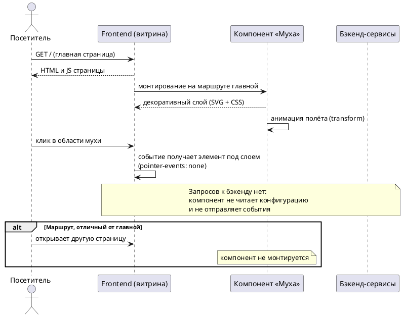

# Functional Requirements Document (FR)

## Фича: Летающая муха на главной странице

**Дата:** 03.11.2026
**Версия:** 1.0
**Статус:** Согласован

**Основание:** Документ разработан на основе [ADR](02-ADR.md) и [BRD](01-BRD.md) (ADR v1.0, BRD v1.0).

---

## 1. Функциональные требования

| ID | Роль | Я хочу | Чтобы | Критерий приёмки |
|---|---|---|---|---|
| FR-01 | Пользователь сайта | видеть анимированную муху при открытии главной страницы | главная выглядела живее и поддерживала образ бренда | При открытии главной страницы отображается муха, и её анимация воспроизводится |
| FR-02 | Пользователь сайта | не видеть муху на остальных страницах сайта | декоративный элемент не отвлекал вне главной | На любом маршруте, кроме главной, компонент не отображается |
| FR-03 | Пользователь сайта | пользоваться элементами страницы в области мухи | клики и переходы работали как обычно | Клик в точке, где находится муха, получает элемент под ней; поведение страницы не меняется |
| FR-04 | Пользователь сайта | не получать реакции при клике или наведении на муху | элемент не воспринимался как интерактивный | Клик и наведение на муху не открывают ссылок, окон и подсказок; курсор не меняется на указатель |
| FR-05 | Пользователь сайта | видеть непрерывную анимацию полёта без собственных действий | эффект присутствия не зависел от пользователя | Анимация запускается автоматически при открытии главной и не требует ввода; действия пользователя её не запускают и не переключают |
| FR-06 | Система | монтировать компонент только на главной странице и без обращения к бэкенду | показ не зависел от конфигурации и доступности сервисов | Компонент подключается в точке монтирования главной; при открытии страницы не выполняется запросов к API и не читается конфигурация из CMS |
| FR-07 | Система | не собирать и не передавать данные о показе и взаимодействии | фича не влияла на приватность и аналитику | Компонент не отправляет сетевых запросов, не пишет события аналитики, не использует cookie и локальное хранилище |
| FR-08 | Система | исключать декоративный слой из взаимодействия и семантики страницы | элемент не мешал навигации и вспомогательным технологиям | Слой не перехватывает указатель, недоступен для фокуса и скрыт от скринридеров |
| FR-09 | Система | не задерживать загрузку и интерактивность главной страницы | появление мухи не ухудшало работу витрины | Страница становится интерактивной независимо от загрузки и воспроизведения анимации; компонент не блокирует первую отрисовку |
| FR-10 | Фронтенд-разработчик | включать и отключать показ выпуском версии фронтенда | не требовалось управление из админ-панели | Показ определяется версией фронтенда; административных экранов, настроек и фича-флага для мухи нет |

---

## 2. Модель данных

**Не требуется.**

ADR-01 фиксирует полностью клиентскую реализацию: данные о показе не хранятся, конфигурация не создаётся. Сущностей, таблиц и связей у фичи нет.

Анимированный персонаж поставляется как статический ассет сборки фронтенда (ADR-02) и не является записью в базе данных.

---

## 3. API-спецификация

**Не требуется.**

Публичных эндпоинтов у фичи нет: ADR-01 исключает обращение к бэкенду, ADR-05 — управление показом. Компонент не запрашивает данные и не отправляет события, поэтому контракты API, форматы ответов и коды ошибок не определяются.

---

## 4. Админ-панель

**Не предусмотрена.**

BR-06 и ADR-05 исключают управление показом: нет табличного списка, детальной страницы, действий и прав доступа. В Admin GUI Backend и CMS изменений не вносится.

---

## 5. Sequence-диаграмма

---

## 6. Нефункциональные требования

| Категория | Требование |
|---|---|
| Производительность | Компонент не инициирует сетевых запросов и не блокирует первую отрисовку; анимация не влияет на интерактивность страницы (ADR-01, ADR-02). Количественные значения в BRD не заданы |
| Безопасность | Нет передачи данных на сторону, нет сторонних скриптов и плееров, нет cookie и локального хранилища (ADR-01, ADR-02). Новых прав и точек аутентификации не появляется |
| Доступность | Элемент декоративный: не перехватывает указатель, не входит в порядок фокуса, скрыт от вспомогательных технологий (ADR-04). Поведение при reduced-motion не зафиксировано — открытый вопрос 1 BRD |
| Совместимость | Целевые браузеры, устройства и разрешения в BRD не заданы. Проверка выполняется в браузерах, поддерживаемых витриной; поведение на мобильных — открытый вопрос 2 BRD |
| Наблюдаемость | События и метрики не собираются (BR-04, ADR-01): оценить эффект фичи количественно нельзя |

---

## 7. Матрица трассировки BR → FR

| BR ID | FR ID |
|---|---|
| BR-01 | FR-01, FR-06 |
| BR-02 | FR-01, FR-05, FR-09 |
| BR-03 | FR-03, FR-04, FR-08 |
| BR-04 | FR-05, FR-07 |
| BR-05 | FR-02, FR-06 |
| BR-06 | FR-06, FR-10 |
| BR-07 | FR-01 |

Все бизнес-требования BR-01–BR-07 покрыты функциональными требованиями.

---

## 8. Открытые вопросы

1. Нужно ли учитывать `prefers-reduced-motion` и отключать или упрощать анимацию? Сейчас FR-05 требует непрерывного полёта без исключений — при появлении требования FR-05 и NFR по доступности будут уточнены.
2. Как муха ведёт себя на мобильных устройствах: тот же компонент, уменьшенный вариант или отсутствие? FR-01 и FR-02 этот случай не разделяют.
3. Должна ли муха оставаться в пределах видимой области и не перекрывать визуально интерактивные элементы? FR-03 гарантирует прохождение кликов, но не исключает визуального перекрытия.
4. Есть ли готовые дизайн-ассеты персонажа (SVG, Lottie, спрайты) и требования к стилю анимации? От этого зависит формат ассета (ADR-02).
5. Нужна ли возможность отключить муху без релиза? FR-10 фиксирует обратное — показ управляется только версией фронтенда.

---

## 9. История изменений

| Версия | Дата | Что изменилось |
|---|---|---|
| 1.0 | 03.11.2026 | Первая версия |
