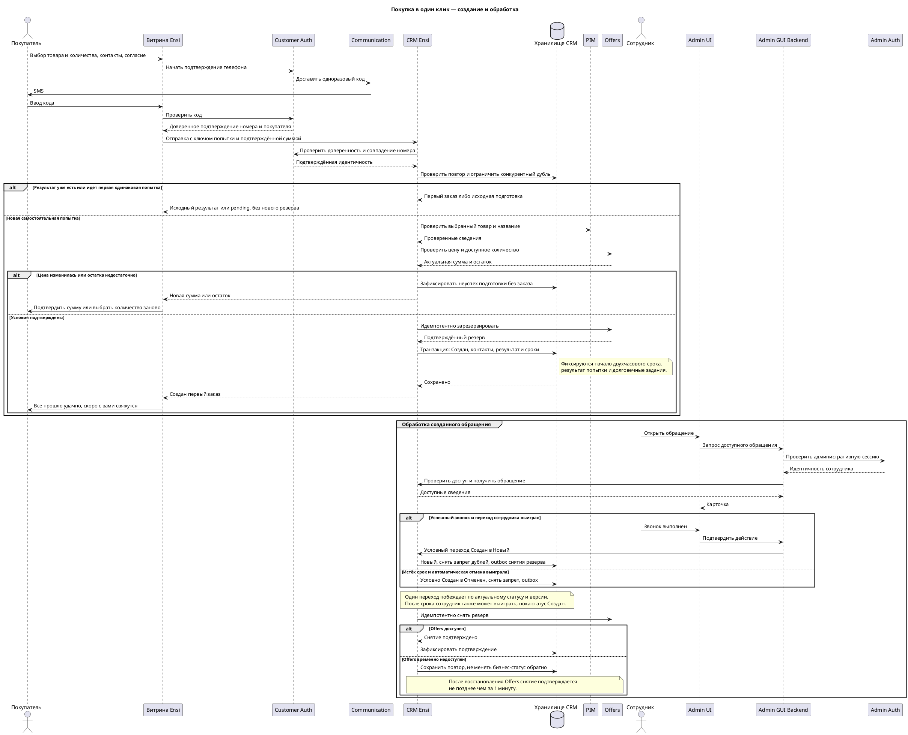

# Functional Requirements Document (FR)

## Фича: Покупка в один клик

**Дата:** 10.11.2026  
**Версия:** 1.0  
**Статус:** Согласован

**Основание:** Документ разработан на основе согласованных [BRD](01-BRD.md) и [ADR](02-ADR.md) (BRD v5.0, ADR v1.1), [карты проекта](../../../PROJECT-MAP.md) v1.1 и ответов пользователя от 10.11.2026 о повторном подтверждении изменившейся суммы, выборе количества при нехватке остатка, исключительных правах администратора на исправление и удаление контактов и допустимости подтверждения заказа после срока, пока статус остаётся «Создан».

Документ описывает целевую доработку. Приведённые публичные маршруты и модель данных предлагаются для реализации и не объявляются существующими API или таблицами Ensi. Внутренние контракты сервисов и конфигурация развёртывания требуют проверки согласно ADR; доступ к ним в этом репозитории отсутствует. Сервисы, хранилище и механизмы восстановления берутся из ADR и здесь не переопределяются.

---

## 1. Функциональные требования

| ID | Как | Я хочу | Чтобы | Критерий приёмки |
|---|---|---|---|---|
| FR-01 | Пользователь сайта | Начать покупку из карточки товара | Обойти корзину и обычное оформление | «Купить в 1 клик» доступно только для товара в наличии, разрешённого к покупке; действие открывает форму для выбранного товара без изменения корзины. |
| FR-02 | Пользователь сайта | Выбрать количество | Купить нужное число единиц | Количество целое, минимум 1, максимум — доступный остаток выбранного предложения; сервер повторно проверяет доступность перед резервом. |
| FR-03 | Пользователь сайта | Указать имя, фамилию и телефон | Передать магазину контакты | Имя и фамилия обязательны и состоят из латинских букв; пробелы, цифры, дефисы и апострофы внутри значений не принимаются; принимается только российский телефон с +7. |
| FR-04 | Пользователь сайта | Подтвердить телефон кодом | Выполнить условие отправки | Customer Auth подтверждает владение именно указанным номером для существующего и нового покупателя; номер, найденный в базе, не освобождает от подтверждения. |
| FR-05 | Пользователь сайта | Понимать цель обработки контактов | Отправить их осознанно | Перед отправкой доступна ссылка на правила и отдельное обязательное согласие без заранее установленной отметки; согласие на рекламу не включено. |
| FR-06 | Пользователь сайта | Подтвердить изменившуюся сумму | Не отправить обращение по неожиданной цене | При изменении цены обращение по новой сумме не создаётся автоматически; показывается новая итоговая сумма в рублях и требуется отдельное подтверждение покупателя. |
| FR-07 | Пользователь сайта | Узнать о нехватке остатка | Выбрать допустимое количество | При нехватке показывается актуальный остаток и предлагается выбрать количество заново; количество не уменьшается молча, при остатке 0 отправка недоступна. |
| FR-08 | Backend-сервис | Проверить выбранный товар и вычислить сумму | Сохранить корректные сведения покупки | Название и идентичность берутся из PIM, цена и остаток — из Offers; сумма рассчитывается сервером в целых копейках и сопоставляется с подтверждённой покупателем суммой. |
| FR-09 | Backend-сервис | Создать обращение в CRM Ensi | Передать заказ сотруднику | После подтверждения телефона и резерва сохраняются контакты, название товара, количество, итоговая сумма и валюта RUB; начальный статус — «Создан»; отдельный заказ OMS не создаётся. |
| FR-10 | Пользователь сайта | Получить достоверный результат | Знать, что обращение создано | Только после создания показывается «Все прошло удачно, скоро с вами свяжутся»; при установленной ошибке — «Произошла ошибка, попробуйте позже»; HTTP 202 и техническая подготовка не являются успехом. |
| FR-11 | Backend-сервис | Повторить ту же попытку после потери ответа | Не создать второй заказ | Повтор с тем же ключом попытки и теми же данными получает результат первой попытки; изменение данных с тем же ключом отклоняется, пока сохранён результат проверки попытки. |
| FR-12 | Backend-сервис | Не создавать одинаковые активные обращения | Исключить дубли | Для одного покупателя с тем же товаром, количеством и суммой существует не более одного заказа в «Создан», включая конкурентные отправки; повтор использует первый заказ и не создаёт второй резерв. |
| FR-13 | Backend-сервис | Разрешить новую одинаковую покупку после обработки | Соблюсти правило снятия запрета дублей | Переход первого заказа из «Создан» снимает запрет новой самостоятельной попытки в той же транзакции; повтор старой сетевой попытки при этом не превращается в новую покупку. |
| FR-14 | Backend-сервис | Зарезервировать выбранное количество | Сохранить товар до обработки | Резерв связан с обращением и логически начинается с его создания в CRM; успех невозможен без подтверждённого резерва; при неуспешном создании техническая бронь компенсируется. |
| FR-15 | Администратор в панели управления — сотрудник магазина | Открыть обращение и зафиксировать успешный звонок | Подтвердить покупку | Сотрудник видит обращение в «Создан» и после успешного звонка выполняет переход в «Новый», в том числе после срока, пока фактический статус ещё «Создан»; фиксируются время изменения и действовавший сотрудник; прямого изменения системных полей нет. |
| FR-16 | Backend-сервис | Автоматически отменить необработанный заказ | Соблюсти срок звонка | Срок равен моменту создания плюс 2 часа; по истечении срока отменяется только заказ, всё ещё находящийся в «Создан», переходом в «Отменен». |
| FR-17 | Backend-сервис | Согласовать конкурирующие смены статуса | Не отменить уже обработанный заказ | Переход сотрудником и автоматическая отмена условны по актуальному статусу и версии записи; даже после срока сотрудник может выиграть, пока статус «Создан»; выигрывает один переход, остальные не повторяют его последствия. |
| FR-18 | Backend-сервис | Завершить резерв после выхода из «Создан» | Освободить товар | При выходе в другой статус логический резерв заканчивается, долговечное задание на снятие сохраняется вместе со статусом; при сбое Offers физическое снятие подтверждается не позднее 1 минуты после его восстановления. |
| FR-19 | Администратор в панели управления | Видеть только доступные обращения | Ограничить доступ к контактам | Список и карточка доступны сотрудникам, которым поручена обработка, и уполномоченному администратору; доступ проверяется через Admin GUI Backend и на стороне CRM. |
| FR-20 | Backend-сервис | Очистить контакты по сроку | Выполнить согласованное правило хранения | Через 90 календарных дней с создания контакты обращения удаляются или обезличиваются; профиль покупателя и отдельные документы покупки не изменяются, контакты из профиля не подставляются вместо очищенного снимка. |
| FR-21 | Пользователь сайта | Обратиться за исправлением или удалением контактов | Управлять данными обращения | Правила содержат канал поддержки; по запросу покупателя контакты исправляет или удаляет только уполномоченный администратор, с проверкой заявителя; профиль и бизнес-статус этим действием не меняются. |
| FR-22 | Backend-сервис | Восстановить результат при сбое | Не потерять обращение или резерв | Неизвестный результат проверяется по исходной операции; резерв и его компенсация идемпотентны, работа продолжается после перезапуска, персональные данные и коды не попадают в журналы. |
| FR-23 | Backend-сервис | Контролировать сроки и нагрузку | Выполнить ограничения проекта | Создание — не более 5 минут от отправки, звонок — 2 часа от создания; наблюдаются нарушения сроков и резервы дольше 1 минуты после восстановления Offers; проверяемый профиль нагрузки — 500 пользователей в день и пик 50 одновременно. |

### 1.1. Поведение формы и переходы

Форма показывает выбранный товар, количество, итоговую сумму в рублях, имя, фамилию, российский телефон и согласие. Подтверждение номера выполняется в этом сценарии через Customer Auth; наличие клиента в базе не раскрывается посетителю. Смена телефона сбрасывает подтверждение прежнего номера. Дополнительные обязательные контакты не запрашиваются.

На отправку создаётся ключ одной попытки. Пока результат неизвестен, повтор запроса и получение результата используют этот же ключ; интерфейс не запускает независимую покупку автоматически. До достоверного результата контакты и выбор сохраняются в состоянии текущей формы, код подтверждения не сохраняется. После изменения цены или количества и явного согласия покупателя начинается новая попытка с новым ключом. При обнаружении существующего одинакового обращения его контакты не перезаписываются данными повтора.

| Исходный статус | Событие | Результат |
|---|---|---|
| Нет бизнес-обращения | Успешно подтверждены телефон, товар, сумма и резерв; выполнено сохранение CRM | Создан; начало резерва и двухчасового срока. |
| Создан | Успешный звонок и подтверждённое действие сотрудника | Новый; запрет дублей снят, логический резерв завершён, задание физического снятия сохранено. |
| Создан | Истекло 2 часа, актуальный статус не изменён | Отменен; те же последствия выхода из «Создан». |
| Новый или Отменен | Задание отмены по прежнему двухчасовому сроку | Статус не меняется, повторных последствий нет. |

Другие ручные переходы не определены основаниями и не становятся доступными по умолчанию. Сам звонок без смены статуса не предотвращает отмену. По прямому ответу пользователя ручное подтверждение после истечения срока разрешено, пока фактический статус всё ещё «Создан»; само сравнение времени не блокирует такой переход.

---

## 2. Модель данных

Целевая модель CRM содержит 5 сущностей; это не утверждение о текущей схеме БД. Имена — snake_case, кодировка UTF8; допустимые типы: `int`, `number`, `string`, `boolean`, `timestamp`. Для денежных значений используется `int` в копейках, `number` для денег не применяется. Конкретные физические типы, ограничения и индексы должны быть сопоставлены с СУБД CRM без изменения решений ADR.

### Сущность: `one_click_orders` — бизнес-обращение

| Поле | Тип | Nullable | Описание |
|---|---|---|---|
| `id` | int | Нет | Идентификатор обращения. |
| `created_at` | timestamp | Нет | Момент фактического создания; начало резерва и двухчасового срока. |
| `updated_at` | timestamp | Нет | Момент последнего изменения. |
| `customer_id` | int | Нет | Доверенная идентичность Customer Auth, не значение из тела запроса. |
| `offer_id` | int | Нет | Идентификатор конкретного выбранного товарного предложения. |
| `product_name` | string | Нет | Снимок названия товара из PIM на момент создания. |
| `quantity` | int | Нет | Целое количество от 1 до доступного остатка. |
| `total_amount` | int | Нет | Итоговая подтверждённая сумма в копейках. |
| `currency` | string | Нет | Единственное значение `RUB`. |
| `status` | string | Нет | `created` — «Создан», `new` — «Новый», `cancelled` — «Отменен». |
| `expires_at` | timestamp | Нет | `created_at` плюс 2 часа; после выхода из `created` не запускает отмену. |
| `version` | int | Нет | Версия для условного изменения состояния. |
| `status_changed_at` | timestamp | Да | Время выхода из исходного статуса. |
| `status_changed_by` | int | Да | Идентификатор сотрудника при ручном переходе; NULL при системной отмене. |
| `contact_changed_at` | timestamp | Да | Время последнего ручного исправления или удаления контактов. |
| `contact_changed_by` | int | Да | Уполномоченный администратор, выполнивший это действие. |
| `reservation_ref` | string | Нет | Подтверждённая связь с резервом Offers. |
| `reservation_released_at` | timestamp | Да | Время подтверждённого физического снятия, отдельно от смены бизнес-статуса. |

### Сущность: `one_click_order_contacts` — отдельный снимок контактов

| Поле | Тип | Nullable | Описание |
|---|---|---|---|
| `id` | int | Нет | Идентификатор снимка. |
| `created_at` | timestamp | Нет | Время временного сохранения в ходе подготовки. |
| `updated_at` | timestamp | Нет | Время изменения связи или очистки. |
| `operation_id` | int | Нет | Исходная попытка, в ходе которой получены контакты. |
| `order_id` | int | Да | До фиксации обращения NULL, после создания — его идентификатор. |
| `first_name` | string | Нет | Имя латиницей; не дублируется в журнале операции. |
| `last_name` | string | Нет | Фамилия латиницей. |
| `phone` | string | Нет | Подтверждённый российский номер в нормализованной форме `+7` и 10 цифр. |
| `phone_verified_at` | timestamp | Нет | Время подтверждения именно этого номера. |
| `consent_version` | string | Нет | Версия правил обработки, с которыми согласился покупатель. |
| `consent_at` | timestamp | Нет | Зафиксированное сервером время согласия. |
| `delete_after` | timestamp | Нет | После создания обращения — его `created_at` плюс 90 календарных дней. |

Очистка может физически удалить строку, поэтому связь обращения с контактом необязательна при чтении. До создания бизнес-обращения контакты хранятся только для восстановления исходной попытки; после окончательного неуспеха и завершённой сверки они удаляются. Неизвестный результат не оправдывает бессрочное хранение: временный снимок имеет предельную дату очистки, не позднее 90 дней от его первичного сохранения. Отдельный профиль Customer Auth этим не удаляется.

### Сущность: `one_click_order_operations` — попытка отправки

| Поле | Тип | Nullable | Описание |
|---|---|---|---|
| `id` | int | Нет | Идентификатор технической операции, возвращаемый публичным API. |
| `created_at` | timestamp | Нет | Серверная отметка первичного получения исходной попытки; сохраняется при первой записи и задаёт начало предела 5 минут. |
| `updated_at` | timestamp | Нет | Последнее изменение результата. |
| `customer_id` | int | Нет | Владелец попытки для проверки доступа. |
| `idempotency_key` | string | Нет | Ключ одной попытки; уникален в рамках покупателя. |
| `request_fingerprint` | string | Да | Контрольная сумма нормализованного запроса; не исходные контакты, очищается вместе с производными контактных данных. |
| `canonical_operation_id` | int | Да | Ссылка на первую операцию при обнаружении одинаковой подготовки или заказа. |
| `offer_id` | int | Нет | Выбранное предложение. |
| `quantity` | int | Нет | Запрошенное количество. |
| `expected_total_amount` | int | Нет | Сумма в копейках, которую подтвердил покупатель; не источник цены. |
| `state` | string | Нет | `pending`, `succeeded`, `failed`; это техническое состояние, не статус заказа. |
| `order_id` | int | Да | Сохранённое первое обращение; при подготовке или неуспехе NULL. |
| `reservation_operation_ref` | string | Да | Идентичность операции Offers для повторов и выяснения результата. |
| `error_code` | string | Да | Терминальная ошибка без персональных данных и текстов внешних сервисов. |
| `completed_at` | timestamp | Да | Момент достоверного завершения. |

Контрольная сумма не считается способом бессрочного хранения контактов: после очистки производных персональных данных повтор не может проверяться по прежнему полному запросу. API возвращает `410 OperationResultExpired`, если безопасное воспроизведение результата конкретной попытки уже невозможно; это не означает отсутствия исторического заказа.

### Сущность: `one_click_order_guards` — запрет одинаковой активной покупки

| Поле | Тип | Nullable | Описание |
|---|---|---|---|
| `id` | int | Нет | Идентификатор ограничения. |
| `created_at` | timestamp | Нет | Начало подготовки или активного заказа. |
| `updated_at` | timestamp | Нет | Последнее изменение связи. |
| `customer_id` | int | Нет | Покупатель. |
| `offer_id` | int | Нет | Товарное предложение. |
| `quantity` | int | Нет | Количество. |
| `total_amount` | int | Нет | Итоговая сумма в копейках. |
| `currency` | string | Нет | `RUB`. |
| `operation_id` | int | Нет | Первая каноническая попытка. |
| `order_id` | int | Да | NULL во время подготовки; затем первый заказ в «Создан». |

Сочетание покупателя, предложения, количества, суммы и валюты уникально среди действующих ограничений. Выход из `created` удаляет ограничение в той же транзакции. Техническая неуспешная подготовка освобождает его после достоверного выяснения результата и необходимых компенсаций. Предварительный поиск без транзакционного ограничения не обеспечивает уникальность.

### Сущность: `one_click_order_tasks` — долговечное задание и outbox

| Поле | Тип | Nullable | Описание |
|---|---|---|---|
| `id` | int | Нет | Идентификатор задания. |
| `created_at` | timestamp | Нет | Время фиксации вместе с изменением CRM. |
| `updated_at` | timestamp | Нет | Последняя попытка или изменение состояния. |
| `operation_id` | int | Да | Связанная попытка, в том числе ещё без заказа. |
| `order_id` | int | Да | Обращение, если уже создано; хотя бы одна из двух связей обязательна. |
| `task_type` | string | Нет | `reconcile_reserve`, `release_reserve`, `cancel_expired`, `purge_contacts`. |
| `operation_key` | string | Нет | Уникальная идентичность побочного действия для идемпотентного исполнения. |
| `state` | string | Нет | `pending`, `running`, `succeeded`; повтор после сбоя не создаёт новое действие. |
| `next_attempt_at` | timestamp | Нет | Когда исполнитель может продолжить. |
| `attempts` | int | Нет | Число попыток. |
| `offers_restored_at` | timestamp | Да | Начало подтверждённой доступности после сбоя для контроля предела снятия резерва. |
| `completed_at` | timestamp | Да | Время достоверного исполнения. |
| `last_error_code` | string | Да | Безопасная категория ошибки без контактов. |

В задания не копируются имя, фамилия, телефон и код подтверждения. Восстановление зависшего `running` не теряет действие. Обнаружение восстановления Offers не должно сдвигать начало согласованной минуты к позднему первому опросу: период проверки и повтор вместе укладываются в предел ADR.

**Связи:** обращение имеет не более одного актуального снимка контактов и много связанных операций и заданий; несколько повторных операций могут ссылаться на один первый заказ; каноническая операция ссылается на себя только косвенно через повторы, циклы запрещены. Customer Auth и Offers доступны по сервисным контрактам, а не через межсервисные внешние ключи и прямые записи в их БД. Сущности подтверждения телефона принадлежат Customer Auth и здесь не дублируются.

---

## 3. API-спецификация

Описаны только 4 публичных эндпоинта сайта; административные и внутренние маршруты сервисов не специфицируются. Реализация должна сопоставить этот целевой контракт с проверенными контрактами развёртывания до интеграции.

### 3.1. Общие правила

- HTTPS, JSON, версия `/v1`, ресурсы во множественном числе в kebab-case; поля и query — snake_case.
- Все идентификаторы — JSON integer; количество и деньги — JSON integer, не дробь, строка или boolean. Суммы передаются в копейках: `150000` означает 1500 рублей, валюта всегда `RUB`.
- Дата и время — строка ISO-8601 UTC. Даты примеров иллюстрируют формат, а не устанавливают срок действия кода или подтверждения.
- Тело ответа содержит только `data`, необязательные `errors` и `meta`. Ошибка: `data: null`, массив `errors` с `code`, `message` и необязательной `meta`. Метаданные верхнего уровня расположены в `meta.one_click`.
- Коды ошибок фиксированы таблицей ниже. Неизвестный маршрут или недоступная владельцу сущность возвращает 404 с `NotFoundHttpException`, без раскрытия чужих данных.
- Доказательство подтверждения телефона выдаёт Customer Auth. Для создания и чтения своей операции нужен `Authorization: Bearer <verification_token>`; CRM проверяет доверенность, срок, идентичность и совпадение номера. Истёкшее подтверждение обновляется через тот же сценарий подтверждения телефона, не создавая заказ автоматически.
- Телефон в запросе создания: нормализованная строка `+7` и 10 цифр, дополнительно проверенная как российский номер. Ограничение только мобильными номерами не вводится. Имя и фамилия после удаления внешних пробелов соответствуют `^[A-Za-z]+$`; число символов и лимиты запросов согласуются с существующими ограничениями развёртывания, новые произвольные значения не устанавливаются.
- Ответы с кодом или доказательством подтверждения не кешируются; доказательство не пишется в URL, постоянное браузерное хранилище и журналы. Одно знание `customer_id` или идентификатора операции не даёт доступа.

| Код ошибки — enum | HTTP | Значение |
|---|---|---|
| `ValidationException` | 422 | Обязательное значение отсутствует, неверный формат или согласие не дано. |
| `PhoneConfirmationDeliveryFailed` | 503 | Отправку кода достоверно выполнить не удалось. |
| `PhoneConfirmationFailed` | 401 | Неверное подтверждение; число попыток контролирует Customer Auth. |
| `PhoneConfirmationExpired` | 410 | Подтверждение кода просрочено. |
| `PhoneProofRequired` | 401 | Нет действующего доверенного подтверждения номера. |
| `PhoneProofMismatch` | 422 | Указанный телефон не совпадает с подтверждённым. |
| `AuthorizationException` | 403 | Операция запрещена в текущем контексте; чужие идентификаторы не раскрываются. |
| `NotFoundHttpException` | 404 | Маршрут или доступный покупателю ресурс не найден. |
| `IdempotencyConflict` | 409 | Тот же ключ попытки использован с изменёнными данными. |
| `PriceChanged` | 409 | Итоговая сумма изменилась, требуется подтверждение новой. |
| `QuantityUnavailable` | 409 | Недостаточно товара для выбранного количества. |
| `ProductUnavailable` | 409 | Товар больше нельзя купить. |
| `OperationResultExpired` | 410 | Безопасное воспроизведение результата старой попытки недоступно после очистки данных. |
| `ThrottleRequestsException` | 429 | Превышен действующий лимит отправок или проверок. |
| `CreationFailed` | 503 | Достоверный терминальный неуспех создания; при неизвестном результате вместо этого используется pending. |
| `ServiceUnavailableException` | 503 | Зависимый сервис недоступен до начала долговечной попытки. |

### 3.2. POST `/v1/phone-confirmations`

**Назначение:** начать подтверждение номера через Customer Auth с доставкой кода через Communication. До подтверждения не возвращаются наличие клиента в базе, его идентификатор, имя или другие данные.

| Поле запроса | Тип | Nullable | Описание |
|---|---|---|---|
| `phone` | string | Нет | Российский номер в согласованном формате. |

**Пример запроса:**

```json
{"phone":"+79991234567"}
```

| Поле ответа | Тип | Nullable | Описание |
|---|---|---|---|
| `data.id` | int | Нет | Идентификатор проверки телефона, не покупателя. |
| `data.challenge_token` | string | Нет | Непрозрачное разрешение продолжить именно эту проверку. |
| `data.expires_at` | timestamp | Нет | Срок по действующей политике Customer Auth. |

**Успех — 201:**

```json
{"data":{"id":701,"challenge_token":"example_challenge_token","expires_at":"2026-11-10T13:05:00Z"}}
```

**Ошибка — 422:**

```json
{"data":null,"errors":[{"code":"ValidationException","message":"Укажите российский номер телефона с +7","meta":{"field":"phone"}}]}
```

**HTTP:** 201, 422, 429, 503. Сроки, лимиты и повторная доставка кода используют проверенную политику Customer Auth; пример даты не задаёт TTL.

### 3.3. POST `/v1/phone-confirmations/{id}/verifications`

**Назначение:** подтвердить код для текущей проверки. `id` — int. Новый покупатель получает доверенную идентичность через Customer Auth после подтверждения; дополнительных контактов для этой фичи не требуется.

| Поле запроса | Тип | Nullable | Описание |
|---|---|---|---|
| `challenge_token` | string | Нет | Разрешение продолжить проверку из предыдущего ответа. |
| `code` | string | Нет | Введённый код; формат задаётся действующей политикой Customer Auth. |

**Пример запроса:**

```json
{"challenge_token":"example_challenge_token","code":"123456"}
```

| Поле ответа | Тип | Nullable | Описание |
|---|---|---|---|
| `data.verification_token` | string | Нет | Непрозрачное доверенное подтверждение номера и покупателя для сценария. |
| `data.verified_at` | timestamp | Нет | Время подтверждения. |
| `data.expires_at` | timestamp | Нет | Действительность результата по политике Customer Auth. |

**Успех — 200:**

```json
{"data":{"verification_token":"example_phone_proof","verified_at":"2026-11-10T13:01:00Z","expires_at":"2026-11-10T13:11:00Z"}}
```

**Ошибка — 401:**

```json
{"data":null,"errors":[{"code":"PhoneConfirmationFailed","message":"Не удалось подтвердить номер телефона"}]}
```

**HTTP:** 200, 401, 404, 410, 422, 429, 503. Код и наличие клиента в базе в ответ не включаются. Привязка проверки, срок, защита от перебора и повторного использования подтверждаются контрактом Customer Auth перед реализацией.

### 3.4. POST `/v1/one-click-orders`

**Заголовки:** `Authorization: Bearer <verification_token>`, `Idempotency-Key: <ключ одной попытки>`, `Content-Type: application/json`.

| Поле запроса | Тип | Nullable | Описание |
|---|---|---|---|
| `offer_id` | int | Нет | Предложение с текущей карточки. |
| `quantity` | int | Нет | От 1 до доступного остатка. |
| `expected_total_amount` | int | Нет | Подтверждённая покупателем сумма в копейках; сервер сравнивает с собственным расчётом. |
| `first_name` | string | Нет | Имя латиницей. |
| `last_name` | string | Нет | Фамилия латиницей. |
| `phone` | string | Нет | Тот же российский номер, владение которым подтверждено. |
| `consent_accepted` | boolean | Нет | Для отправки необходимо true. |
| `consent_version` | string | Нет | Версия доступных покупателю правил; проверяется сервером. |

`customer_id`, бизнес-статус, название товара, отметки времени и валюта не принимаются на доверии из запроса; валюта задаётся сервером как RUB. Неизвестные поля запроса отклоняются с 422.

**Пример запроса:**

```json
{"offer_id":101,"quantity":2,"expected_total_amount":150000,"first_name":"Anna","last_name":"Ivanova","phone":"+79991234567","consent_accepted":true,"consent_version":"one_click_privacy_v1"}
```

| Поле ответа | Тип | Nullable | Описание |
|---|---|---|---|
| `data.id` | int | Нет | Идентификатор операции отправки, а не заказа. |
| `data.state` | string | Нет | `pending`, `succeeded` или `failed`. |
| `data.created_at` | timestamp | Нет | Начало этой операции. |
| `data.order.id` | int | Да | Идентификатор первого созданного обращения; весь `order` равен null до результата. |
| `data.order.initial_status` | string | Да | `created` на момент создания; не API текущего отслеживания заказа. |
| `data.order.created_at` | timestamp | Да | Момент создания первого обращения. |
| `data.order.offer_id` | int | Да | Предложение созданного обращения. |
| `data.order.quantity` | int | Да | Сохранённое количество. |
| `data.order.total_amount` | int | Да | Сохранённая сумма в копейках. |
| `data.order.currency` | string | Да | `RUB`. |
| `data.error_code` | string | Да | Код терминального неуспеха, если state failed. |
| `meta.one_click.replayed` | boolean | Нет | Повтор той же попытки с сохранённым результатом. |
| `meta.one_click.duplicate` | boolean | Нет | Использовано первое одинаковое обращение или его исходная подготовка. |
| `meta.one_click.deadline_exceeded` | boolean | Нет | Создание вышло за 5 минут; для завершённой попытки учитывается длительность до создания или завершения, а не возраст на момент опроса; флаг не подменяет исход. |

**Создано — 201:**

```json
{"data":{"id":801,"state":"succeeded","created_at":"2026-11-10T13:02:00Z","order":{"id":901,"initial_status":"created","created_at":"2026-11-10T13:02:01Z","offer_id":101,"quantity":2,"total_amount":150000,"currency":"RUB"},"error_code":null},"meta":{"one_click":{"replayed":false,"duplicate":false,"deadline_exceeded":false}}}
```

**Результат ещё не установлен — 202:**

```json
{"data":{"id":801,"state":"pending","created_at":"2026-11-10T13:02:00Z","order":null,"error_code":null},"meta":{"one_click":{"replayed":false,"duplicate":false,"deadline_exceeded":false}}}
```

202 возвращается только после долговечной фиксации операции, без текста об успехе. Если ответ потерян до получения id, повторяется POST с тем же ключом и данными. Если id получен, результат запрашивается через GET операции. Просрочка пяти минут обнаруживается как нарушение, а не как автоматическое расширение срока или доказательство отсутствия заказа. Интерфейс показывает сообщение об ошибке и при последующей попытке продолжает выяснение исходного результата, не создавая независимый заказ вслепую.

**Одинаковый заказ уже существует — 200:** форма данных та же, `data.order.id` — первый заказ, `meta.one_click.duplicate: true`; контакты первого заказа и его резерв не изменяются. Если первая подготовка ещё не завершена, возвращается 202 с привязкой к её результату. После выхода первого заказа из «Создан» новая попытка с новым ключом разрешена. Повтор исходного ключа возвращает исходный результат даже после смены статуса.

**Цена изменилась — 409:**

```json
{"data":null,"errors":[{"code":"PriceChanged","message":"Цена изменилась. Подтвердите новую итоговую сумму","meta":{"offer_id":101,"quantity":2,"total_amount":160000,"currency":"RUB"}}]}
```

Клиент показывает новую сумму, получает явное подтверждение и отправляет новую попытку с новым ключом. По ошибке PriceChanged бизнес-обращение не создано; технические удержания этой неуспешной подготовки компенсируются, если возникли.

**Остаток уменьшился — 409:**

```json
{"data":null,"errors":[{"code":"QuantityUnavailable","message":"Выберите количество заново","meta":{"offer_id":101,"available_quantity":1}}]}
```

При остатке 0 нельзя отправить новое обращение до появления доступного товара; при положительном остатке покупатель заново выбирает количество, видит пересчитанную сумму и подтверждает отправку с новым ключом.

**Данные не прошли проверку — 422:**

```json
{"data":null,"errors":[{"code":"ValidationException","message":"Имя должно содержать только латинские буквы","meta":{"field":"first_name"}}]}
```

**HTTP:** 201 — создано; 200 — сохранённый результат или первое обращение; 202 — обработка с неизвестным пока исходом; 401 — нет подтверждения; 403 — действие запрещено; 404 — ресурс не найден; 409 — конфликт ключа, цены, количества или доступности; 410 — результат попытки очищен; 422 — неверные данные; 429 — лимит; 503 — достоверный неуспех либо недоступность до долговечной фиксации. Для 503 тело содержит соответствующий код из enum. Неизвестный результат не маркируется CreationFailed.

### 3.5. GET `/v1/one-click-order-operations/{id}`

**Назначение:** узнать исход только своей ранее сохранённой операции. `id` — int, тело отсутствует. Нужен действующий proof в Authorization; если он обновлён, идентичность покупателя должна оставаться той же. Этот эндпоинт не предоставляет историю чужого покупателя или контакты заказа.

**Пример запроса:** `GET /v1/one-click-order-operations/801` с Authorization. JSON тела запроса отсутствует.

**Ответ — 200:** формат `data` и `meta.one_click` полностью совпадает с POST создания. `pending` означает продолжение выяснения результата, `succeeded` — первый созданный заказ, `failed` — достоверный неуспех с `error_code` из enum. Сохранённый результат создания содержит `initial_status`, а не текущий бизнес-статус заказа.

```json
{"data":{"id":801,"state":"succeeded","created_at":"2026-11-10T13:02:00Z","order":{"id":901,"initial_status":"created","created_at":"2026-11-10T13:02:01Z","offer_id":101,"quantity":2,"total_amount":150000,"currency":"RUB"},"error_code":null},"meta":{"one_click":{"replayed":true,"duplicate":false,"deadline_exceeded":false}}}
```

**Ошибка — 404:** одинаковая для отсутствующей и чужой операции.

```json
{"data":null,"errors":[{"code":"NotFoundHttpException","message":"Операция не найдена"}]}
```

**HTTP:** 200, 401, 404, 410, 429, 503. Опрос не меняет бизнес-статус, не обновляет начало двухчасового срока и не создаёт резерв повторно.

---

## 4. Админ-панель

### Экран: Табличный список «Покупки в один клик»

Доступ через Admin UI → Admin GUI Backend → CRM. По умолчанию сортировка `id` по убыванию. Обработчик видит обращения, к обработке которых имеет доступ; уполномоченный администратор — обращения в пределах своих полномочий магазина. Конкретные идентификаторы существующих ролей и прав сопоставляются при интеграции, новые назначения пользователям автоматически не выдаются.

| Поле | Поле в БД | Фильтрация | Обязательность | Сортировка |
|---|---|---|---|---|
| Номер обращения | `one_click_orders.id` | Да | Да | Да |
| Создано | `created_at` | Да, диапазон | Да | Да |
| Товар | `product_name`, `offer_id` | Да, по предложению | Да | Нет |
| Количество | `quantity` | Нет | Да | Нет |
| Итоговая сумма, ₽ | `total_amount`, `currency` | Нет | Да | Нет |
| Статус | `status` | Да | Да | Да |
| Имя и фамилия | `one_click_order_contacts.first_name`, `last_name` | Нет | Пока контакты не очищены | Нет |
| Телефон | `one_click_order_contacts.phone` | Нет | Пока контакты не очищены | Нет |
| Срок звонка | `expires_at` | Нет | Да | Да |

Сумма отображается в рублях, хотя хранится и передаётся в копейках. После удаления контактов отображается «Контакты удалены»; профиль покупателя не используется для восстановления этих полей. Отсутствие контакта не скрывает заказ и не меняет статус.

### Экран: Детальная страница обращения

| Поле | Поле в БД | Редактируемость | Обязательность |
|---|---|---|---|
| Номер, время создания и обновления | `id`, `created_at`, `updated_at` | Нет | Да |
| Товар и количество | `offer_id`, `product_name`, `quantity` | Нет | Да |
| Итоговая сумма и валюта | `total_amount`, `currency` | Нет | Да |
| Статус | `status` | Только действием «Звонок выполнен», не свободным вводом | Да |
| Срок звонка | `expires_at` | Нет | Да |
| Имя и фамилия | `first_name`, `last_name` контакта | Только уполномоченный администратор по запросу покупателя | До удаления контакта |
| Телефон и подтверждение | `phone`, `phone_verified_at` контакта | Только уполномоченный администратор с проверкой нового номера | До удаления контакта |
| Резерв | `status`, `reservation_ref`, `reservation_released_at` | Нет | Да |
| Время и сотрудник изменения статуса | `status_changed_at`, `status_changed_by` | Нет | Если статус менялся |
| Время и администратор изменения контактов | `contact_changed_at`, `contact_changed_by` | Нет | Если контакты исправлялись или удалялись вручную |

Состояние резерва показывается понятными обозначениями: «Зарезервировано», «Ожидает снятия», «Снят». Оно не является дополнительным бизнес-статусом заказа. При временном сбое Offers сотрудник может видеть ожидание снятия уже после изменения статуса.

### Действия и права доступа

| Действие | Кто может | Ограничения |
|---|---|---|
| Просмотреть список и карточку | Сотрудник, которому поручена обработка; уполномоченный администратор | Только обращения в разрешённой области доступа; одинаковая проверка в интерфейсе, BFF и CRM. |
| Создать обращение вручную в админ-панели | Не предусмотрено этой фичей | Бизнес-обращение создаётся из сценария покупателя после подтверждения телефона. |
| Подтвердить успешный звонок | Сотрудник, которому поручена обработка; уполномоченный администратор | Только переход `created` → `new`, условный по текущей версии и статусу; время и исполнитель сохраняются. |
| Подтвердить звонок после двухчасового срока | Те же роли | Разрешено по прямому ответу пользователя, пока фактический статус ещё `created`; если отмена уже победила, действие отклоняется, заказ не восстанавливается автоматически. |
| Произвольно менять статус или вручную отменять | Не определено согласованными основаниями | Дополнительные переходы не выдаются по умолчанию. |
| Исправить контакты по запросу покупателя | Только уполномоченный администратор | Подтверждается принадлежность запроса покупателю по процессу поддержки; имя и фамилия сохраняют согласованный формат, новый телефон должен быть подтверждён через Customer Auth; профиль покупателя сам по себе не меняется. |
| Удалить контакты по запросу покупателя | Только уполномоченный администратор | Удаляются снимок и производные контактов в технических данных; сам заказ, его статус и профиль не удаляются этим действием; фиксируются время и администратор без старых значений контактов. |
| Удалить бизнес-обращение | Не предусмотрено | Для этой фичи согласована очистка контактов, а не удаление истории заказа. |
| Автоматически отменить по сроку | Фоновый процесс CRM | Не ранее истечения 2 часов и только при сохранении `created`; исключает повторную отмену. |
| Очистить контакты через 90 дней | Фоновый процесс CRM | Право автоматической очистки не даёт сотруднику право ручного удаления. |

Повторное нажатие сотрудником не повторяет снятие резерва и не меняет время успешного перехода. При конфликте интерфейс перечитывает статус и сообщает, что обращение уже изменено. Наличие звонка без сохранённого перехода не считается обработкой для условия отмены.

Подтверждённые пользователем новые полномочия относятся только к контактам обращения. Точный канал поддержки, способ проверки заявителя и действующая связь между административными ролями и правами должны быть заполнены настройками магазина перед запуском; адреса, сотрудники и технические идентификаторы ролей не выдумываются.

---

## 5. Sequence-диаграмма



Диаграмма показывает основной успешный поток и ключевые развилки. Неизвестный ответ Offers обрабатывается восстановлением исходной операции из ADR-04, а не трактуется как подтверждённый резерв; в этом случае публичный результат pending и сообщение об успехе не показывается. Техническая подготовка не добавляет новые бизнес-статусы.

---

## 6. Нефункциональные требования

| Категория | Требование |
|---|---|
| Создание | Не более 5 минут от отправки до создания CRM, измеряемых по серверной отметке первичного получения исходной попытки; возврат 202 не означает выполнения этого предела. Превышение фиксируется как нарушение, а не автоматически становится успешным созданием. |
| Звонок | Двухчасовой срок начинается от `one_click_orders.created_at`; результат звонка отражается переходом в «Новый». Пользователь разрешил ручной переход после срока, пока заказ фактически в «Создан». |
| Резерв | Логический резерв заканчивается при выходе из «Создан»; после временного сбоя физическое снятие в Offers подтверждается не более чем за 1 минуту от его восстановления. |
| Нагрузка | Проектный профиль — около 500 пользователей в день, 50 одновременных пользователей. Это не требование 50 одновременных отправок или заданный RPS; для нагрузочной проверки нужны распределение действий и ресурсы среды. |
| Достоверность | Внешние тайм-ауты не доказывают отсутствие заказа; повторы и сверка используют первоначальную идентичность операции, побочные действия идемпотентны. |
| Конкурентность | Смена статуса, прекращение запрета дублей и outbox фиксируются одной транзакцией CRM; физическая согласованность Offers достигается механизмом ADR, общей транзакции двух БД нет. |
| Телефон и доступ | Подтверждение привязано к номеру и покупателю; проверка одной российской строки не заменяет владение. Административные действия проверяются в BFF и CRM, публичные операции доступны только владельцу. |
| Контакты | Только имя, фамилия и телефон; отдельное согласие без рекламы, доступ уполномоченным ролям, очистка через 90 календарных дней. Полный телефон, имена, коды и доказательства подтверждения не попадают в логи и outbox. |
| Ручная очистка | По запросу покупателя контакты исправляет или удаляет только уполномоченный администратор; исходные значения не сохраняются в диагностике, статус и резерв сами по себе не меняются. |
| Денежные значения | Целые копейки и валюта RUB; итог вычисляется сервером, цена и количество не изменяются без явного решения покупателя. |
| Доступность | Процент SLA не задан; неуспех зависимого сервиса показывается честно, операции восстановления и нарушения сроков наблюдаемы. |
| Совместимость | Используются текущая витрина и Admin UI; список поддерживаемых браузеров и размеры экранов берутся из требований магазина, конкретные версии не выдумываются. |
| Срок проекта | Месяц после согласования всех документов фичи; согласование этого FR не означает согласования ещё не подготовленных тест-кейсов. |

Сроки очистки, исполнения автоматической отмены после точного дедлайна и реакция на отказ самого фонового исполнителя требуют эксплуатационной детализации. Согласованная минута касается снятия резерва после восстановления Offers; она не является общим разрешением задерживать отмену, создание или очистку на минуту.

---

## 7. Матрица трассировки BR → FR

| BR ID | FR ID |
|---|---|
| BR-01 | FR-01 |
| BR-02 | FR-01, FR-09 |
| BR-03 | FR-03, FR-09 |
| BR-04 | FR-09, FR-22, FR-23 |
| BR-05 | FR-02, FR-08, FR-09 |
| BR-06 | FR-09, FR-15, FR-16, FR-17 |
| BR-07 | FR-01, FR-02, FR-07, FR-08 |
| BR-08 | FR-02, FR-07 |
| BR-09 | FR-04 |
| BR-10 | FR-03 |
| BR-11 | FR-03, FR-04 |
| BR-12 | FR-15, FR-16, FR-17, FR-23 |
| BR-13 | FR-06, FR-07, FR-09, FR-10, FR-22 |
| BR-14 | FR-11, FR-12, FR-13 |
| BR-15 | FR-14, FR-18 |
| BR-16 | FR-16, FR-17 |
| BR-17 | FR-05, FR-19, FR-20, FR-21, FR-22 |

| Решение ADR | Отражение в FR |
|---|---|
| ADR-01 | FR-09, модель CRM и публичный контракт создания. |
| ADR-02 | FR-03–04, подтверждение телефона и доверенная идентичность. |
| ADR-03 | FR-11–13, сущности операций и ограничений. |
| ADR-04 | FR-08, FR-14, FR-18, FR-22; резерв, восстановление и outbox. |
| ADR-05 | FR-15–18; условные переходы и проверка актуального статуса. |
| ADR-06 | FR-10, FR-22–23; pending, предельные сроки и наблюдаемость. |
| ADR-07 | FR-05, FR-19–21; контакты, администрирование и очистка. |

Дополнительные прямые ответы пользователя: FR-06 и FR-07 — новая сумма и остаток; FR-17 — разрешённое подтверждение после срока до фактической отмены; FR-21 и раздел 4 — исключительные полномочия уполномоченного администратора для ручного изменения контактов.

---

## 8. Открытые вопросы

1. Проверить фактические версии и контракты CRM, Customer Auth, Communication, PIM и Offers в инсталляции; подтвердить операции резерва, выяснения неизвестного исхода и идемпотентного снятия. Это зависимость интеграции из ADR, а не объявление готовых возможностей.
2. Сопоставить целевые публичные маршруты с входной точкой витрины, формат доверенного подтверждения с Customer Auth, а также определить действующие TTL кода и proof, ограничения повторной отправки и перебора; без проверки не вводить произвольные числовые значения.
3. Получить адрес правил обработки, их версию и действующий канал поддержки, процесс проверки заявителя и идентификаторы уже существующих административных прав. Новые полномочия по исправлению и удалению контактов утверждены пользователем только для уполномоченного администратора.
4. Уточнить допустимые технические задержки фоновой отмены и очистки при отказе исполнителя, эксплуатационный контроль восстановления Offers и расписание, обеспечивающее подтверждённую минуту снятия резерва.
5. Уточнить представление вариантов товара и связь `offer_id` с карточкой в текущей витрине. Этот контракт требует конкретного предложения; поддержка произвольного выбора разных вариантов не объявляется готовой функцией.
6. Подтвердить ограничения длины имён и технических ключей, совместимость браузеров, конфигурацию ресурсов и распределение пользовательских действий для нагрузочного сценария.

Основные бизнес-вопросы о цене, остатке, ручных правах на контакты и подтверждении после срока закрыты прямыми ответами пользователя. Перечисленные интеграционные данные должны быть получены перед реализацией соответствующих частей; QA не должен выдавать неизвестные значения за проверяемые ожидаемые результаты.

---

## 9. История изменений

| Версия | Дата | Что изменилось |
|---|---|---|
| 1.0 | 10.11.2026 | Подготовлены функциональные требования на основе согласованных BRD v5.0 и ADR v1.1, а также ответов о цене и остатке; описаны 23 сценария с критериями, 5 сущностей данных, 4 публичных контракта, админ-панель, последовательность и трассировка; учтены прямые ответы о ручных правах на контакты и подтверждении после срока; документ представлен на согласование, тест-кейсы не создавались. |
| 1.0 | 10.11.2026 | Пользователь явно согласовал FR v1.0 сообщением «согласовано»; статус изменён на «Согласован», версия и содержание требований сохранены; проверены согласованные основания BRD v5.0 и ADR v1.1, их актуальные ссылки и готовность передачи документов роли QA; открытые интеграционные вопросы раздела 8 сохранены. |
