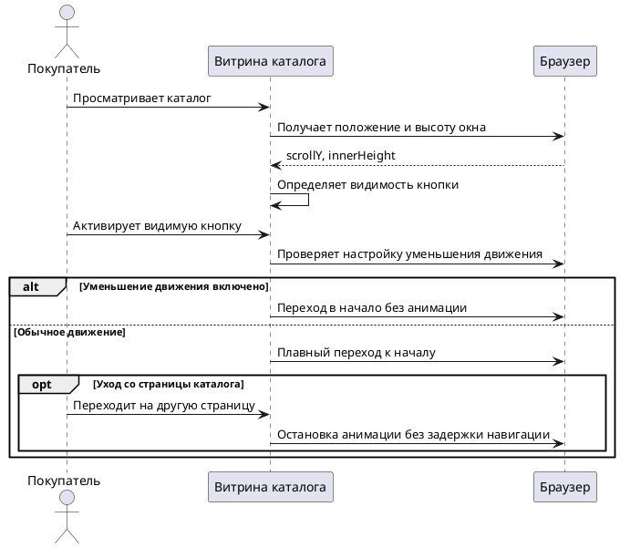

# Functional Requirements Document (FR)

## Фича: Кнопка прокрутки наверх страницы

**Дата:** 16.11.2026  
**Версия:** 2.0  
**Статус:** Согласован

**Основание:** документ разработан на основе согласованных [BRD](01-BRD.md) и [ADR](02-ADR.md) (BRD v3.0, ADR v3.0).

## 1. Функциональные требования

| ID | Как | Я хочу | Чтобы | Критерий приёмки |
|---|---|---|---|---|
| FR-01 | Покупатель | видеть кнопку только в каталоге товаров | использовать её при просмотре каталога | На страницах каталога работает логика FR-02–03; на остальных страницах кнопка фичи отсутствует. Точный перечень маршрутов требует проверки (Q-01). |
| FR-02 | Покупатель | видеть кнопку при достижении второго экрана | вернуться к началу | В каталоге кнопка видна, когда `scrollY >= innerHeight`, включая равенство. При `scrollY < innerHeight` она скрыта, в том числе при прокрутке вверх. При открытии и повторном открытии каталога состояние определяется текущей позицией и пересчитывается с учётом её восстановления. |
| FR-03 | Покупатель | получать актуальное состояние кнопки при изменении окна | видеть кнопку по текущему порогу | При изменении размера или ориентации окна видимость пересчитывается по текущим `scrollY` и `innerHeight` без дополнительной прокрутки. |
| FR-04 | Покупатель | находить кнопку справа вверху | быстро её использовать | Активная кнопка расположена в правой верхней части видимой области поверх других кнопок. Точные отступы не заданы; компоновка и доступность перекрываемых элементов требуют проверки (Q-02). |
| FR-05 | Покупатель | активировать кнопку | вернуться к началу страницы | При обычной настройке движения активация запускает плавный переход к верхней позиции страницы; длительность составляет 300–500 мс независимо от расстояния, если переход не прерван. |
| FR-06 | Покупатель | завершить запущенный переход к началу | получить предсказуемый результат | В пределах страницы каталога взаимодействия пользователя не прерывают плавную прокрутку; повторная активация до её завершения ничего не меняет и не запускает новую анимацию. При уходе со страницы действует FR-11. |
| FR-07 | Покупатель с настройкой уменьшения движения | перейти наверх без необязательного движения | комфортно пользоваться сайтом | При `prefers-reduced-motion: reduce` активация сразу переводит страницу в начало; необязательные анимации кнопки и перехода отключены. |
| FR-08 | Покупатель, пользующийся клавиатурой | находить и активировать видимую кнопку | вернуться наверх без мыши | Видимая кнопка достигается клавиатурой, имеет видимый фокус и активируется штатными клавишами кнопки. Скрытая кнопка не входит в порядок фокуса; если она скрывается с текущим фокусом, фокус переносится на кнопку «Главная страница». Наличие и доступность цели требуют проверки (Q-04). |
| FR-09 | Покупатель, пользующийся экранным диктором | получить доступное название кнопки | пользоваться элементом с помощью диктора | Элемент имеет семантику HTML-кнопки и доступное название `scroll button`; видимая текстовая надпись не нужна. Соответствие названия WCAG 2.2 AA требует проверки (Q-05). |
| FR-10 | Покупатель | пользоваться кнопкой на поддерживаемых устройствах | получить доступное и предсказуемое поведение | Выполняются требования WCAG 2.2 AA, а также критерии FR-01–09 на платформах и браузерах раздела 6, включая масштабирование и смену ориентации. |
| FR-11 | Пользователь сайта | покинуть страницу каталога | перейти на другую страницу без влияния анимации | При уходе со страницы каталога активная анимация прекращается и её ресурсы и обработчики освобождаются; она не задерживает навигацию и не изменяет положение прокрутки новой страницы. Функция не делает запрос на сервер при показе или активации кнопки. |

Для администратора и backend-сервиса новых пользовательских действий нет: согласованный ADR ограничивает фичу витриной и не вводит серверного состояния или администрирования.

## 2. Модель данных

Новых сущностей, полей и связей БД нет: состояние видимости и анимации относится к текущей странице и не сохраняется на сервере согласно ADR-01. Таблица полей и связи неприменимы.

## 3. API-спецификация

Новых публичных API-эндпоинтов нет: показ и нажатие кнопки не требуют сетевых запросов согласно ADR-01. Запросы, ответы и коды ошибок для этой фичи неприменимы; существующая загрузка каталога не меняется этим документом.

## 4. Админ-панель

Новых экранов, полей, действий и прав нет: в BRD и ADR управление кнопкой через админ-панель не предусмотрено. Таблицы действий и прав неприменимы.

## 5. Sequence-диаграмма

## 6. Нефункциональные требования

| Область | Требование или ограничение |
|---|---|
| Время перехода | 300–500 мс независимо от расстояния при обычной настройке движения и отсутствии прерывания; проверить на поддерживаемых устройствах. При уменьшении движения переход мгновенный. |
| Доступность | WCAG 2.2 AA, клавиатура, экранные дикторы и видимый фокус для всех указанных платформ и браузеров. |
| Устройства | Мобильные устройства, планшеты и настольные компьютеры; проверять ориентацию, масштаб и изменение размера окна. |
| Обязательные браузеры | Windows: Chrome, Edge, Firefox; macOS: Safari, Chrome; Android: Chrome; iOS / iPadOS: Safari. |
| Дополнительный приоритет | Android: Samsung Internet и Firefox. |
| Версии | Две последние стабильные основные версии перечисленных браузеров; пользователь сообщил, что общей матрицы совместимости продукта нет (Q-06). |
| Безопасность и хранение | Новые серверные данные, права и сетевые запросы для функции не вводятся; дополнительные специальные требования безопасности в основаниях не установлены. |

## 7. Матрица трассировки

| BR | FR |
|---|---|
| BR-01 | FR-01, FR-11 |
| BR-02 | FR-02 |
| BR-03 | FR-05 |
| BR-04 | FR-02 |
| BR-05 | FR-03 |
| BR-06 | FR-04 |
| BR-07 | FR-05, FR-06, FR-11 |
| BR-08 | FR-07 |
| BR-09 | FR-08, FR-09, FR-10 |
| BR-10 | FR-08 |
| BR-11 | FR-09 |
| BR-12 | FR-02 |

Решения ADR-01, ADR-02 и ADR-03 отражены соответственно в FR-01–03 и FR-11, FR-05–07 и FR-11, FR-04 и FR-08–10.

## 8. Открытые вопросы

### Ответы пользователя, учтённые в FR v2.0

Статус ответа не означает, что техническая проверка выполнена или что FR согласован.

| ID | Ответ и связь с требованиями | Статус |
|---|---|---|
| Q-01 | Только каталог товаров; пользователь указал «Поддерживается». Учтено в FR-01. Конкретные маршруты и механизм прокрутки не перечислены. | Частично уточнён 16.11.2026; техническая проверка остаётся открытой. |
| Q-02 | Кнопка справа вверху поверх других кнопок, точные отступы не заданы. Учтено в FR-04. | Закрыт ответом пользователя 16.11.2026; проверка доступности остаётся открытой. |
| Q-03 | В пределах страницы каталога переход не прерывается, повторное нажатие ничего не меняет. При уходе со страницы переход прекращается. Учтено в FR-06 и FR-11. | Закрыт ответами пользователя 16.11.2026. |
| Q-04 | При скрытии кнопки с фокусом фокус переносится на кнопку «Главная страница». Учтено в FR-08. | Закрыт ответом пользователя 16.11.2026; проверка цели фокуса остаётся открытой. |
| Q-05 | Доступное название `scroll button`, видимая текстовая надпись не нужна. Учтено в FR-09. | Закрыт ответом пользователя 16.11.2026; проверка WCAG остаётся открытой. |
| Q-06 | Общей матрицы совместимости продукта нет. Учтено в разделе 6. | Закрыт ответом пользователя 16.11.2026. |
| Q-07 | При уходе со страницы каталога анимация прекращается без задержки навигации и изменения позиции новой страницы; при повторном открытии учитывается восстановленная позиция. Учтено в FR-02 и FR-11. | Закрыт ответом пользователя 16.11.2026; проверка реализации восстановления остаётся открытой. |

### Остаётся проверить

| Проверка | Связь | Статус |
|---|---|---|
| Маршруты каталога, контейнер прокрутки и механизм восстановления позиции. При расхождении с `scrollY` и `innerHeight` вынести противоречие пользователю. | FR-01–03, FR-11; Q-01, Q-07 | Открыта: исходники витрины не подтверждены. |
| Наличие и доступность кнопки «Главная страница» как цели фокуса; доступность кнопок под активной кнопкой прокрутки. | FR-04, FR-08; Q-02, Q-04 | Открыта: требуется проверка интерфейса и WCAG. |
| Соответствие названия `scroll button` WCAG 2.2 AA и возможность обеспечить непрерываемость и заданное время на поддерживаемых устройствах. | FR-05–06, FR-09–10; Q-03, Q-05 | Открыта: при обнаружении противоречия согласовать решение с пользователем. |

## 9. История изменений

| Версия | Дата | Что изменилось |
|---|---|---|
| 1.0 | 16.11.2026 | По согласованным BRD v1.0 и ADR v1.0 подготовлены 11 FR, трассировка и открытые вопросы; документ представлен на согласование. |
| 1.0 | 16.11.2026 | Документ помечен устаревшим после смыслового изменения BRD до v2.0; требуется переработка по повторно согласованным BRD и ADR. Основания этой версии остаются BRD v1.0 и ADR v1.0. |
| 1.0 | 16.11.2026 | Статус «Устарел» сохранён после изменения BRD до v3.0; переработка ожидает согласованных оснований. Основания этой версии не менялись. |
| 2.0 | 16.11.2026 | По согласованным BRD v3.0 и ADR v3.0 переработаны требования, диаграмма и трассировка: учтены ответы о расположении, непрерываемости, фокусе, названии, совместимости, уходе со страницы и восстановлении позиции. Статусы ответов и оставшиеся проверки выделены; FR представлен на согласование. |
| 2.0 | 16.11.2026 | Пользователь согласовал FR v2.0 фичи scroll-to-top; статус изменён на «Согласован», содержание сохранено. |
