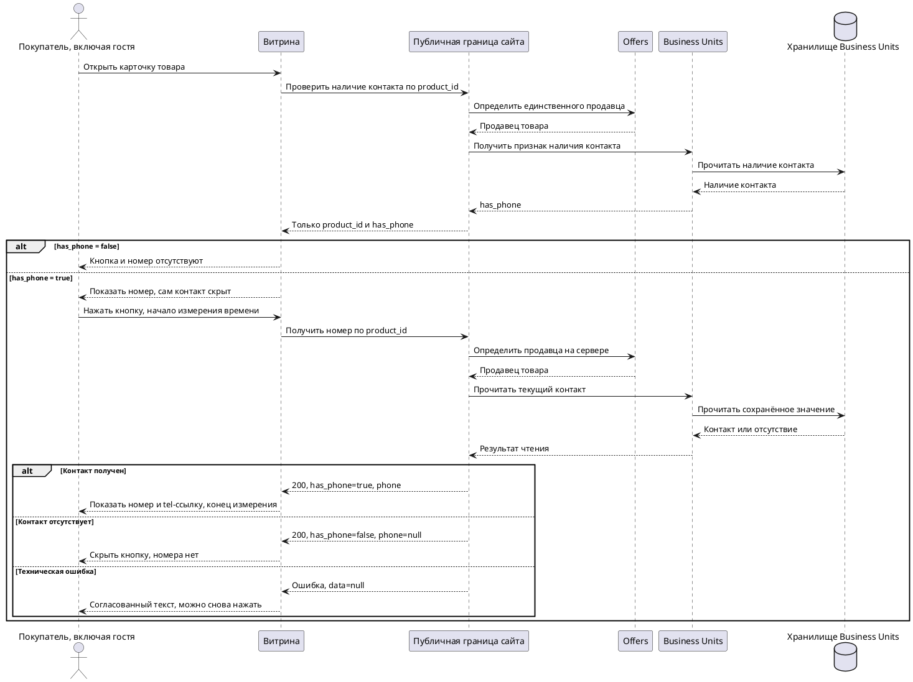

# Functional Requirements Document (FR)

## Фича: Раскрытие телефона продавца в карточке товара

**Дата:** 11.11.2026
**Версия:** 1.0
**Статус:** Согласован

**Основание:** документ разработан на основе согласованных [BRD](01-BRD.md) и [ADR](02-ADR.md) (BRD v1.0, ADR v1.0), [карты проекта](../../../PROJECT-MAP.md) v1.1 и уточнения пользователя от 11.11.2026: контент-менеджер может очистить ранее заданный номер, после чего кнопка скрывается с карточек товаров продавца.

Это целевые требования к доработке. Названия новых полей, публичные маршруты и ответы ниже предлагаются в составе FR v1.0, а не описывают проверенную реализацию. Физическое размещение публичной границы и соответствие существующим контрактам остаются вопросами реализации из ADR.

## 1. Функциональные требования

### 1.1. User Story и критерии приёмки

| ID | Как | Я хочу | Чтобы | Критерий приёмки |
|---|---|---|---|---|
| FR-01 | Покупатель, включая гостя | Получить действие «Показать номер» при наличии контакта | Связаться с продавцом товара | При `has_phone=true` кнопка отображается, при `false` отсутствует; вход в аккаунт не требуется. До получения признака кнопка раскрытия не показывается. |
| FR-02 | Backend сайта | Определять продавца по товару | Возвращать контакт единственного продавца этого товара | Связь разрешается на сервере через Offers по товарному контексту. Клиент не задаёт произвольного продавца; для разных товаров одного продавца используется один источник контакта. |
| FR-03 | Покупатель | Получить номер только после нажатия | Раскрыть скрытый контакт осознанным действием | До нажатия номера нет в отображении, исходной разметке, скрытых элементах и начальных данных карточки. Предварительно передаётся только признак наличия. |
| FR-04 | Покупатель | Раскрыть номер на текущей странице | Сохранить контекст карточки товара | Нажатие запускает отдельное чтение номера; навигация и перезагрузка страницы не происходят. |
| FR-05 | Покупатель | Понимать, что раскрытие выполняется | Дождаться результата своей попытки | Пока запрос выполняется, действие находится в состоянии загрузки; повторное нажатие в этот момент не создаёт параллельную попытку из этого компонента. |
| FR-06 | Покупатель | Увидеть раскрытый контакт | Прочитать номер продавца | При успешном ответе с номером он показывается в формате `+7 (XXX) XXX-XX-XX` и доступен как телефонная ссылка; сообщение прежней ошибки отсутствует. |
| FR-07 | Покупатель | Получить сообщение при ошибке | Понимать, что номер не удалось получить | При сетевой ошибке, техническом завершении запроса по таймауту, ошибочном HTTP-ответе или несогласованной структуре ответа показывается ровно «Произошла ошибка. Попробуйте зайти чуть позже». Номер и телефонная ссылка не появляются. |
| FR-08 | Покупатель | Снова нажать кнопку после ошибки | Повторить попытку без перезагрузки | После завершившейся ошибкой попытки «Показать номер» снова доступна; нажатие запускает новое чтение и снимает прежнее сообщение на время загрузки. |
| FR-09 | Покупатель | Получить результат для текущего товара и текущей попытки | Не увидеть чужой или устаревший контакт | Поздний ответ отменённой или предыдущей попытки, а также ответ для карточки, которую пользователь уже покинул, не изменяет текущий компонент. |
| FR-10 | Покупатель | Не видеть предложение раскрыть отсутствующий номер | Не выполнять бессмысленное действие | Отсутствующий контакт даёт `has_phone=false`. Если контакт исчез между проверкой наличия и нажатием, ответ раскрытия с `false` переводит компонент в состояние отсутствия номера и скрывает кнопку. |
| FR-11 | Покупатель с телефоном | Нажать на раскрытый номер | Начать звонок средствами устройства | Нажатие на номер использует `tel:` с тем же номером в международной записи; само раскрытие звонок не инициирует. На iPhone и Android доступен переход к системному сценарию звонка. |
| FR-12 | Контент-менеджер | Просматривать, задавать и изменять общий номер продавца в админке | Управлять контактом для покупателей | Контакт находится в карточке продавца; после успешного сохранения повторное чтение возвращает сохранённый номер, используемый для всех его товаров. |
| FR-13 | Контент-менеджер | Вводить российский номер с Inputmask | Соблюдать выбранный формат ввода | Применяется фиксированный префикс `+7` и десять цифровых позиций без добавочного номера. Непустое незавершённое значение не сохраняется средствами проверки завершённости маски; дополнительных правил проверки телефонного номера нет. |
| FR-14 | Контент-менеджер | Очистить номер и сохранить изменение | Убрать действие раскрытия с карточек продавца | Пустое значение сохраняется как отсутствие контакта. После успешного сохранения последующие проверки наличия возвращают `false`, кнопка скрывается. Карточка продавца не удаляется. |
| FR-15 | Backend админки | Проверять административный доступ | Разрешать изменение контакта только уполномоченному контент-менеджеру | Изменение проходит через Admin GUI Backend, Admin Auth и Business Units. Без административной сессии или права изменения контакт не меняется; доступность элемента в интерфейсе не заменяет серверную проверку. |
| FR-16 | Backend сайта | Читать контакт у владельца данных | Не расходиться с общим контактом продавца | Номер читается в Business Units по ADR-01; копии в товарах, общая кешируемая выдача номера и прямой доступ к чужой базе не вводятся. Диагностические журналы не содержат номер. |
| FR-17 | Покупатель | Получить номер не позднее 3 секунд | Быстро перейти к связи с продавцом | При одновременном нажатии 50 пользователей каждый получает отображённый номер за время не более 3 секунд от своего нажатия. Измерение включает сеть, серверную обработку и отображение. |
| FR-18 | Покупатель и контент-менеджер | Пользоваться функцией на поддерживаемых устройствах | Выполнять сценарии в своей среде | Проверяются последние три версии Chrome, Яндекс.Браузера, Edge, Opera, Firefox и мобильных систем iPhone/Android по BRD; точные номера версий фиксируются в материалах проверки. |

### 1.2. Состояния компонента раскрытия

| Состояние | Условие | Отображение и действия |
|---|---|---|
| Проверка наличия | Признак наличия контакта ещё не получен | Кнопка раскрытия и номер не отображаются. Выполняется только проверка наличия. |
| Номера нет | Получен `has_phone=false` | Кнопки, номера и телефонной ссылки нет. |
| Номер скрыт | Получен `has_phone=true`, попытка ещё не выполняется | Доступна «Показать номер»; самого номера в компоненте нет. |
| Загрузка номера | Начата текущая попытка | Номер не отображается; повторное нажатие не запускает ещё один запрос до завершения попытки. |
| Номер раскрыт | Успех с `has_phone=true` и номером | Вместо действия раскрытия показан номер как телефонная ссылка. |
| Ошибка раскрытия | Попытка завершилась ошибкой | Показаны установленный текст ошибки и доступная «Показать номер» для ручного повтора. |
| Ошибка проверки наличия | Не удалось получить первоначальный признак | Показан тот же текст ошибки; наличие не подменяется значением `false`. Кнопка раскрытия не появляется до успешного получения признака. При повторном открытии карточки проверка выполняется заново. |

Первоначальная проверка не запрашивает полный номер. Состояние загрузки или ошибки одной карточки не переносится на другую. Автоматическое обновление уже раскрытого номера на открытых страницах после изменения контакта в админке не предусматривается: следующие чтения получают текущее значение из источника.

## 2. Модель данных

### 2.1. Сущность: продавец — логическое расширение существующей записи Business Units

Физическое имя существующей таблицы и соответствующие поля необходимо проверить в целевой инсталляции. Далее `sellers` и `public_phone` — целевые логические обозначения; новая самостоятельная таблица контактов не создаётся.

| Поле | Тип | Nullable | Описание |
|---|---|---|---|
| `id` | int | Нет | Существующий идентификатор продавца. |
| `public_phone` | string | Да | Общий номер для покупателей в записи `+7` и десять цифр; `null` означает отсутствие контакта. |
| `created_at` | timestamp | Да | Существующее время создания записи продавца; не создаётся заново при изменении телефона. |
| `updated_at` | timestamp | Да | Время последнего сохранённого изменения записи согласно существующей модели сервиса. |

**Представление номера:** визуальная маска — `+7 (___) ___-__-__`, где каждая позиция — цифра. В данных хранится номер без пробелов, скобок и дефисов; клиентское форматирование не меняет цифры. Пустое пользовательское значение, включая незаполненный шаблон маски, означает `null`; частично заполненное непустое значение не считается очисткой.

Номер выводится текстовым значением, а не интерпретируется как HTML. Ссылка строится с фиксированным префиксом `tel:` и тем же номером; произвольный адрес ссылки из сохранённого контакта не используется. Это правила безопасного представления из ADR-04, а не дополнительная проверка телефонного номера.

Inputmask выбрана пользователем; библиотека предназначена для ввода в заданном формате, см. [официальное описание](https://github.com/RobinHerbots/Inputmask). Конкретная версия и способ интеграции выбираются после проверки стека админки. Сведения об операторе, действительности номера, принадлежности продавцу и национальной нумерации дополнительно не проверяются; серверная бизнес-валидация телефонного формата не добавляется сверх решения «только маска».

**Связи:** у каждого товара в рамках фичи один продавец; у продавца может быть несколько товаров. Связь разрешается через Offers по ADR-02. Идентификатор продавца не вычисляется по номеру телефона. Контакт не переносится в запись товара и не дублируется при чтении. Изменение номера не меняет связь товара с продавцом.

**Производные значения:** `has_phone=true`, когда у продавца есть сохранённый контакт; иначе `false`. Пустые значения существующей инсталляции должны быть сопоставлены с отсутствием контакта при подготовке доработки; конкретное сопоставление проверяется по FR-Q-01.

### 2.2. Временное состояние интерфейса

Для текущего компонента нужны товарный контекст, состояние из раздела 1.2 и идентичность попытки. Они не являются новыми сущностями БД. После перехода на другой товар прежняя попытка не получает права менять новый компонент. Долговечные записи попыток раскрытия не требуются.

## 3. API-спецификация

### 3.1. Общие правила целевого публичного контракта

- Оба маршрута — чтение через публичную серверную границу сайта, доступны гостю без `Authorization` и не меняют контакт продавца.
- Префикс версии — `/v1`; параметры и JSON-поля — в `snake_case`. `seller-phone` и `seller-phone-availability` — одиночные подресурсы товара, поскольку продавец и его общий контакт единственны.
- Запросы и ответы используют JSON там, где есть тело; для GET тело отсутствует. Ответы имеют `Content-Type: application/json`.
- Корневые поля ответа — `data`, необязательные `errors` и `meta`. В приведённых ответах `meta` не используется.
- Клиент передаёт только `product_id` в пути. Сервер разрешает продавца самостоятельно и не принимает подмену продавца дополнительным параметром.
- Для обоих публичных ответов используется `Cache-Control: no-store`: проверка наличия должна отражать последующее чтение источника после очистки контакта, а номер не должен попадать в общий кеш. Полный номер не включается в ответ проверки наличия.
- Примеры номеров ниже — только иллюстрация формата, не реальные контакты продавцов и не инструкция совершать звонок. Идентификатор `101` — пример, а не факт наличия товара на стенде.

### 3.2. GET `/v1/products/{product_id}/seller-phone-availability`

**Назначение:** определить, нужно ли предлагать раскрытие контакта, не выдавая номер.

**Параметры запроса:**

| Поле | Место | Тип | Обязательность | Описание |
|---|---|---|---|---|
| `product_id` | path | int | Да | Положительный целочисленный идентификатор товара. |

**Пример запроса:**

```http
GET /v1/products/101/seller-phone-availability
Accept: application/json
```

Тело запроса и дополнительные query-параметры не требуются.

**Параметры успешного ответа:**

| Поле | Тип | Nullable | Описание |
|---|---|---|---|
| `data.product_id` | int | Нет | Идентификатор запрошенного товара. |
| `data.has_phone` | boolean | Нет | Наличие общего контакта единственного продавца товара. |

**200 — контакт есть:**

```json
{
  "data": {
    "product_id": 101,
    "has_phone": true
  }
}
```

**200 — контакт отсутствует:**

```json
{
  "data": {
    "product_id": 101,
    "has_phone": false
  }
}
```

Поле `phone` и любые другие представления номера в этом ответе отсутствуют. Ошибки описаны в разделе 3.4 и не должны превращаться в успешный ответ `has_phone=false`.

### 3.3. GET `/v1/products/{product_id}/seller-phone`

**Назначение:** получить текущий общий номер продавца после действия покупателя. Клиентский компонент вызывает этот маршрут по нажатию, а не заранее; доступность публичного маршрута не является защитой от программного обращения.

**Параметры запроса:**

| Поле | Место | Тип | Обязательность | Описание |
|---|---|---|---|---|
| `product_id` | path | int | Да | Положительный целочисленный идентификатор товара. |

**Пример запроса:**

```http
GET /v1/products/101/seller-phone
Accept: application/json
```

Тело запроса и дополнительные query-параметры не требуются.

**Параметры успешного ответа:**

| Поле | Тип | Nullable | Описание |
|---|---|---|---|
| `data.product_id` | int | Нет | Идентификатор запрошенного товара. |
| `data.has_phone` | boolean | Нет | Признак наличия контакта на момент чтения источника. |
| `data.phone` | string | Да | Тот же сохранённый общий номер в записи `+7` и десять цифр; `null`, если контакта нет. |

**200 — номер получен:**

```json
{
  "data": {
    "product_id": 101,
    "has_phone": true,
    "phone": "+70000000000"
  }
}
```

Для этого примера отображение — `+7 (000) 000-00-00`, ссылка — `tel:+70000000000`. Это форматный пример, не подтверждённый телефон. Схема `tel:` и международная запись соответствуют [RFC 3966, раздел 8](https://www.rfc-editor.org/rfc/rfc3966#section-8).

**200 — контакт отсутствует, в том числе после очистки между первоначальной проверкой и нажатием:**

```json
{
  "data": {
    "product_id": 101,
    "has_phone": false,
    "phone": null
  }
}
```

При `false` номер и ссылка отсутствуют в компоненте, кнопка скрывается. Это отсутствие контакта, а не техническая ошибка получения. Значения `has_phone=true` с `phone=null` или `false` с ненулевым номером нарушают контракт и обрабатываются клиентом как ошибка по FR-07.

### 3.4. Ошибки обоих публичных маршрутов

Enum поля `errors[].code` для этой фичи: `InvalidArgumentException`, `NotFoundHttpException`, `SellerPhoneUnavailable`, `InternalServerError`.

| HTTP | `code` | Условие | `message` |
|---|---|---|---|
| 400 | `InvalidArgumentException` | Некорректный `product_id`: не положительное целое число. | `Некорректный идентификатор товара` |
| 404 | `NotFoundHttpException` | Запрошенный товар не найден. | `Товар не найден` |
| 404 | `NotFoundHttpException` | Неизвестный публичный маршрут. | `Ресурс не найден` |
| 503 | `SellerPhoneUnavailable` | Не удалось достоверно получить связь с продавцом или данные контакта из-за недоступности зависимых операций. | `Произошла ошибка. Попробуйте зайти чуть позже` |
| 500 | `InternalServerError` | Непредвиденная ошибка обработки. | `Произошла ошибка. Попробуйте зайти чуть позже` |

**Пример ошибки 503:**

```json
{
  "data": null,
  "errors": [
    {
      "code": "SellerPhoneUnavailable",
      "message": "Произошла ошибка. Попробуйте зайти чуть позже"
    }
  ]
}
```

**Пример ошибки 404:**

```json
{
  "data": null,
  "errors": [
    {
      "code": "NotFoundHttpException",
      "message": "Товар не найден"
    }
  ]
}
```

Для любого ошибочного ответа действуют одинаковые поля `data=null` и `errors`; технические трассы и номера в ошибки не включаются. В компоненте раскрытия любой такой сбой даёт ровно текст из BRD, независимо от диагностического кода. При сетевом сбое HTTP-ответа может не быть, но поведение компонента остаётся тем же. Отсутствие покупательской сессии не является причиной 401/403.

Ни один из кодов не утверждает существование соответствующих обработчиков в текущей инсталляции: это проектируемый контракт FR v1.0. Числовой таймаут запроса отдельно не задан; предел 3 секунды является критерием успешного раскрытия, а не автоматически установленным моментом показа ошибки.

## 4. Админ-панель

Административные эндпоинты не специфицируются. Используется существующий путь Admin UI → Admin GUI Backend → Admin Auth / Business Units из ADR-03.

### 4.1. Экран: существующий список продавцов

Новый список для фичи не создаётся. Список используется для перехода к карточке нужного продавца. Следующая таблица задаёт используемый контекст, не утверждая фактические названия существующих колонок.

| Поле | Поле в БД | Фильтрация в рамках фичи | Обязательность отображения | Сортировка в рамках фичи |
|---|---|---|---|---|
| Идентификатор продавца | `id` | По существующим возможностям списка | Да | По `id` по убыванию по умолчанию, согласно шаблону FR |
| Контакт для покупателей | `public_phone` | Новая фильтрация не требуется | Новая колонка не требуется; контакт доступен в карточке | Новая сортировка по номеру не требуется |

Физический состав и существующий доступ к списку проверяются по FR-Q-01; фича не создаёт новые права управления продавцами в целом.

### 4.2. Экран: карточка продавца

| Поле | Поле в БД | Редактируемость | Обязательность |
|---|---|---|---|
| Идентификатор продавца | `id` | Нет | Да |
| Телефон для покупателей | `public_phone` | Контент-менеджером через Inputmask | Нет; допускается очистка |
| Дата создания | `created_at` | Нет | По существующей модели продавца |
| Дата обновления | `updated_at` | Нет, изменяется системой | По существующей модели продавца |

**Ввод и сохранение:**

1. Для контакта применяется Inputmask в формате `+7 (___) ___-__-__`: десять цифровых позиций после фиксированного `+7`, без добавочных номеров.
2. Полностью заполненный номер сохраняется без разделителей; после повторного открытия показывается тот же номер в маске.
3. Полностью очищенное значение сохраняется как `null`. Одна маска без введённых цифр не считается контактом.
4. Частично заполненное непустое значение не сохраняется, пока маска не завершена или значение не очищено целиком; прежнее сохранённое значение при этом не меняется. Проверка завершённости относится к самой маске.
5. Дополнительных проверок телефонного номера, поиска оператора, проверки принадлежности, подтверждения кодом и правил добавочных нет. Административные права проверяются независимо от правил номера.
6. Только успешное сохранение меняет контакт в источнике. Ошибка сохранения не должна выглядеть как успешное изменение или очистка.

### 4.3. Действия и права доступа

| Действие | Кто может | Ограничения |
|---|---|---|
| Открыть доступную карточку продавца и контакт | Контент-менеджер в рамках действующего доступа к продавцу | Нужна административная сессия; область существующего доступа не расширяется автоматически. |
| Задать или изменить номер | Контент-менеджер с правом изменения контакта | Через существующую административную границу; применяются правила Inputmask. |
| Очистить номер | Тот же контент-менеджер | Очищается только контакт, а не запись продавца; подтверждено пользователем 11.11.2026. |
| Изменить системные поля | Не предусмотрено пользовательским действием | `id` и даты не редактируются свободно. |
| Создать или удалить продавца целиком | Не определяется этой фичей | Существующие права и действия не меняются. |
| Изменить контакт из публичной части сайта | Не предусмотрено | Публичные операции — только чтение; покупательская авторизация не даёт административного права. |

Имена действующих технических разрешений требуют проверки, см. FR-Q-01. Новые полномочия продавца, других сотрудников или администратора помимо описанного права контент-менеджера не назначаются.

## 5. Sequence-диаграмма

Участники и путь чтения соответствуют ADR v1.0. Проверка наличия показана отдельно от раскрытия; сохранение контакта следует административному маршруту из раздела 4.



Недоступность Offers, Business Units и сети обрабатывается как техническая ошибка, даже если соответствующий шаг на схеме не завершился успешным ответом. Каждая повторная попытка после ошибки выполняет новое чтение; поздние ответы проверяются по текущему товару и попытке.

## 6. Нефункциональные требования

| Категория | Требование и способ оценки | Основание |
|---|---|---|
| Время раскрытия | Не более 3 секунд для каждого из 50 пользователей, одновременно нажавших кнопку. Начало — фактическое нажатие у пользователя; конец — отображение номера, а не только получение ответа сервером. Среднее значение или процентиль не заменяют предел для каждого. | BRD, раздел 8; FR-17; ADR-05. |
| Нагрузка | Проверяется заданное одновременное нажатие 50 пользователей. Новые требования к запросам в секунду, длительности пика или суточной аудитории не вводятся. | Последнее уточнение нагрузки в BRD. |
| Совместимость | Последние три версии Chrome, Яндекс.Браузера, Edge, Opera, Firefox, а также мобильных систем iPhone/Android; проверяются раскрытие, повтор, маска в админке и начало звонка в применимых средах. Конкретные номера версий фиксируются при подготовке проверки, а не объявляются здесь фактически проверенными. | BRD; FR-18. |
| Административный доступ | Проверка сессии и права изменения выполняется на сервере; публичное чтение не получает права записи. | FR-15; ADR-03. |
| Разделение данных | До нажатия номер не передаётся клиенту, включая скрытые данные карточки; общий кеш публичных страниц не содержит ответов раскрытия. | FR-03, FR-16; ADR-02, ADR-05. |
| Диагностика | Существующими средствами фиксируются исход и длительность технических вызовов без самого номера; отдельная статистика раскрытий и звонков не создаётся. | ADR-06. |
| Надёжность состояния | Ошибка или поздний ответ не раскрывают номер другого товара и не блокируют повтор после завершившейся ошибкой попытки. | FR-08–09; ADR-06. |
| Доступность | Числовой показатель доступности и отдельный норматив времени до сообщения об ошибке не заданы. Для фактических сбоев действует FR-07; показатель раскрытия остаётся не более 3 секунд. | BRD и ADR-05. |
| Срок реализации | 2 недели после согласования документов; этот проектный срок не является измерением задержки отдельного запроса и не считается начавшимся при согласовании только ADR. | BRD, раздел 8. |

## 7. Матрица трассировки BR → FR

| BR ID | FR ID |
|---|---|
| BR-01 | FR-01, FR-02 |
| BR-02 | FR-03 |
| BR-03 | FR-04, FR-06, FR-09 |
| BR-04 | FR-04–05, FR-08 |
| BR-05 | FR-06, FR-11, FR-18 |
| BR-06 | FR-02, FR-12, FR-16 |
| BR-07 | FR-12, FR-14–15 |
| BR-08 | FR-01, FR-10, FR-14 |
| BR-09 | FR-07 |
| BR-10 | FR-13 |
| BR-11 | FR-13 |
| BR-12 | FR-08–09 |

Требования FR-17–18 дополнительно трассируются в нефункциональные рамки BRD. Очистка контакта в FR-14 конкретизирует редактирование необязательного поля по BR-07–08 и прямому ответу пользователя от 11.11.2026.

| Решение ADR | Отражение в FR |
|---|---|
| ADR-01 | FR-12, FR-14, FR-16; раздел 2. |
| ADR-02 | FR-01–04, FR-10; раздел 3. |
| ADR-03 | FR-15; раздел 4. |
| ADR-04 | FR-06, FR-11, FR-13; представление номера в разделах 2 и 4. |
| ADR-05 | FR-16–17; правила кеширования и раздел 6. |
| ADR-06 | FR-05, FR-07–09, FR-16; состояния компонента и диагностика. |

## 8. Открытые вопросы

Бизнес-правила и сценарий нагрузки заданы в согласованном BRD; дополнительный профиль нагрузки не запрашивается. Уточнение пользователя о возможности очистки номера учтено в FR-14.

| ID | Технический вопрос | Действие и влияние |
|---|---|---|
| FR-Q-01 | Физическое место публичной границы, существующие операции Offers/Business Units, контакт для покупателей, имена полей и административных разрешений не проверены. | Сопоставить целевую модель с инсталляцией по ARCH-Q-01–02 из ADR; перед реализацией определить, что переиспользуется и что дорабатывается. Логические имена и маршруты этого FR не являются доказательством существования операций. |
| FR-Q-02 | Не выбрана версия Inputmask для фактического стека админки и не выполнена проверка на матрице поддержки. | Выбрать совместимую версию и проверить заданный формат и очистку. Выбор не должен добавлять бизнес-валидацию номера или менять поддерживаемые платформы без согласования. |
| FR-Q-03 | Не предоставлены реализация, стенд, тестовые роли и фикстуры, наблюдаемость и фактическая конфигурация технических таймаутов. | Получить перед выполнением проверок. По FR нет результатов тестирования или доказательства выполнения трёхсекундного требования. |

Для этих вопросов не задаются вымышленные адреса, учётные данные или результаты измерений. Противоречие установленным архитектурным решениям требует пересмотра ADR по общим правилам, а не скрытой замены архитектуры внутри реализации FR.

## 9. История изменений

| Версия | Дата | Что изменилось |
|---|---|---|
| 1.0 | 11.11.2026 | На основе согласованных BRD v1.0 и ADR v1.0 и ответа пользователя об очистке номера подготовлены 18 FR, целевое расширение одной существующей сущности продавца, два публичных GET-маршрута, административные действия и права, sequence-диаграмма, нефункциональные требования и трассировка. Технические вопросы к инсталляции сохранены; документ представлен на согласование. |
| 1.0 | 11.11.2026 | Получено явное согласование FR v1.0 фичи seller-phone-reveal сообщением пользователя «согласую» в ответ на запрос согласования конкретной версии. Установлен статус «Согласован»; 18 FR, публичный контракт и основания BRD v1.0, ADR v1.0 сохранены. |
