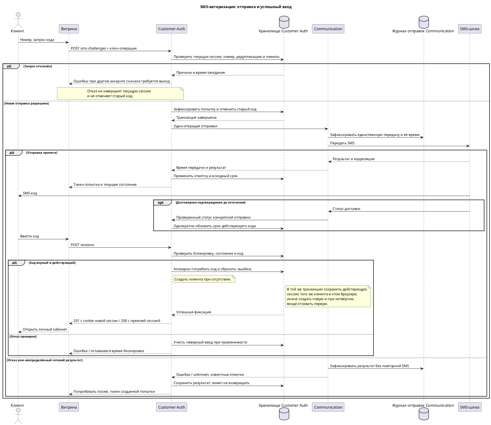

# Functional Requirements Document (FR)

## Фича: Авторизация по номеру телефона с одноразовым SMS-кодом

**Дата:** 09.11.2026  
**Версия:** 1.0  
**Статус:** Согласован

**Основание:** Документ разработан на основе [ADR](02-ADR.md) и [BRD](01-BRD.md) (ADR v1.0, BRD v1.0; оба документа согласованы). Контекст: [PROJECT-MAP.md](../../PROJECT-MAP.md) v1.1.

Документ детализирует поведение и предлагает контракты для согласования. API и модель данных ниже не объявляются уже реализованными. Выбор сервисов, хранилищ и механизмов защиты принят в ADR и здесь не меняется. Обнаруженные неоднозначности перечислены в разделе 8; зависимые от них сценарии не считаются окончательно определёнными.

## 1. Функциональные требования

### 1.1. User Story

| ID | Как | Я хочу | Чтобы | Критерий приёмки |
|---|---|---|---|---|
| FR-01 | Пользователь сайта | Ввести российский мобильный номер | Получить код на свой телефон | Принимается только канонический номер в формате `+7` и 10 цифр без пробелов и разделителей; принадлежность российским мобильным номерам проверяется сервером; другие форматы, страны и типы номеров отклоняются без SMS и создания аккаунта. |
| FR-02 | Пользователь сайта | Запросить SMS-код | Начать вход | Разрешённый запрос создаёт попытку для указанного номера и передаёт SMS шлюзу; существование аккаунта не требуется и до проверки кода не раскрывается. |
| FR-03 | Система | Создать шестизначный код для попытки | Проверить владение номером | Код — строка ровно из 6 десятичных цифр, включая возможные ведущие нули; проверка привязана к конкретной попытке и номеру. |
| FR-04 | Пользователь сайта | Видеть актуальное состояние запроса | Понимать, можно ли вводить код или повторить отправку | Клиент получает состояние, серверное время, текущий срок и время следующей отправки; фронт не считает первоначальный срок неизменным после подтверждения доставки. |
| FR-05 | Система | Ограничить срок действия | Не принимать просроченный код | Без подтверждения срок — 5 минут от передачи шлюзу; если подтверждение получено до истечения, срок — 5 минут от подтверждения; в момент истечения код уже не принимается. |
| FR-06 | Система | Применять только достоверные статусы | Не продлевать код повторно или ошибочно | Первое проверенное подтверждение применяется один раз; дубликат, подделка или статус другой отправки не меняют срок; поздний статус не восстанавливает истёкший, использованный или отменённый код. |
| FR-07 | Пользователь сайта | Повторить отправку через 2 минуты | Получить новый код, если предыдущий не пришёл | По действию «код не пришёл» повтор разрешён через 120 секунд от передачи предыдущей SMS шлюзу, даже если доставка подтверждена; старый код отменяется при принятии новой разрешённой попытки, в том числе при её последующей ошибке. |
| FR-08 | Система | Ограничить отправки на номер | Соблюсти лимит SMS | Максимум 3 принятые попытки отправки за любые последние 600 секунд, включая неуспешные; конкурентные запросы не обходят лимит; отклонённый до создания попытки запрос SMS не отправляет. |
| FR-09 | Система | Считать неверные вводы по номеру | Защитить вход от перебора | После третьего учитываемого отказа за любые последние 600 секунд устанавливается блокировка на 600 секунд; смена попытки и браузера её не обходят; успешный вход сбрасывает накопленные ошибки. Несовпадающий, просроченный и отменённый код учитываются; неверный формат и уже использованный код не учитываются. |
| FR-10 | Пользователь сайта | Узнать время окончания блокировки | Повторить вход после ожидания | Во время блокировки код не проверяется, новая сессия и новая отправка SMS не создаются; сообщение «попытки исчерпаны, попробуйте снова через (оставшееся время)» содержит оставшееся время; после окончания доступны 3 новые попытки. |
| FR-11 | Новый клиент | Подтвердить номер | Получить аккаунт и кабинет | Успешная проверка автоматически создаёт аккаунт только при его отсутствии и открывает кабинет; до подтверждения аккаунт не создаётся; параллельные запросы не создают дубликаты. |
| FR-12 | Вернувшийся клиент | Подтвердить свой номер | Войти в существующий кабинет | Успех связан с существующим клиентом этого номера; новый аккаунт для него не создаётся. |
| FR-13 | Система | Принять код не более одного раза | Исключить повторное использование | Потребление кода, создание аккаунта при необходимости и изменение сессий согласованы атомарно; при двух конкурентных проверках успех получает не более одной, при откате код не помечается использованным отдельно от результата. |
| FR-14 | Клиент | Войти с нового устройства | Использовать кабинет максимум на трёх устройствах | При 3 действующих сессиях успешный вход с четвёртого контекста завершает самую раннюю и создаёт новую; неуспешный вход не отзывает существующие сессии. При повторном успешном подтверждении того же номера в том же браузере действующая сессия сохраняется без замены и без создания дополнительной; число сессий и порядок их создания не меняются. Для входа под другим номером в этом браузере сначала требуется выход из текущего аккаунта. |
| FR-15 | Клиент | Выйти из кабинета | Завершить доступ на текущем устройстве | Выход отзывает только текущую сессию и удаляет её cookie; другие сессии продолжают действовать. |
| FR-16 | Клиент | Сохранять вход | Не подтверждать номер при каждом посещении | Вход не прекращается по прикладному тайм-ауту или закрытию браузера при сохранённой cookie; исключения — собственный выход и отзыв первой сессии при четвёртом входе. Удаление cookie не гарантирует восстановление входа. |
| FR-17 | Система | Проверять действительность сессии | Не предоставлять доступ после отзыва | Защищённая операция без действующей серверной сессии отклоняется; после выхода или отзыва старая cookie не даёт доступа. |
| FR-18 | Пользователь сайта | Получить понятный отказ при сбое SMS | Попробовать позже | При известном отказе либо неопределённом результате отправки отображается предложение повторить попытку позже; аккаунт/сессия от запроса SMS не создаются; ошибка не восстанавливает старый код и не возвращает учтённую отправку. |
| FR-19 | Система | Различать повтор запроса и новую отправку | Не отправлять дубликат SMS из-за сетевого повтора | Одна операция отправки с одним ключом идемпотентности имеет одну учтённую попытку; повтор возвращает её состояние, а не новую SMS; новый разрешённый запрос имеет новый ключ. |
| FR-20 | Система | Не раскрывать коды и секреты | Защитить подтверждение и доступ | В публичных ответах и журналах нет SMS-кода, его проверочного значения, ключей шлюза и идентификатора сессии; идентификатор сессии передаётся только защищённой cookie. |
| FR-21 | Пользователь сайта | Входить только по SMS | Использовать согласованный способ входа | В этой фиче нет входа по паролю, звонку, почте или стороннему аккаунту, смены номера и восстановления утраченного номера. |
| FR-22 | Система | Сохранять результат обработки и безопасно отказывать | Не обходить ограничения при сбоях | Перезапуск не обнуляет действующие лимиты и отзыв; при недоступности авторитетного состояния вход и отправка без учёта не разрешаются; фиксируются технические идентификаторы и результат без секретов. |

Администратор не является участником входа. Основания не задают ему действий по кодам или сессиям; новые User Story администратора не вводятся, см. раздел 4.

### 1.2. Временные правила и состояния

Все моменты времени — серверные, в UTC; единица интервалов API — целая секунда. Пусть `now` — время принятия решения сервером.

- События скользящего окна учитываются в интервале `(now − 600 секунд, now]`: событие ровно 10 минут назад уже не входит в окно.
- До передачи шлюзу код не считается отправленным; известная отметка передачи `t_send` задаёт первоначальный срок `t_send + 300 секунд` и разрешение повтора `t_send + 120 секунд`.
- Без подтверждения код допустим при `now < t_send + 300 секунд`. При первом достоверном подтверждении в `t_confirm < текущего срока` новый срок — `t_confirm + 300 секунд`.
- В момент `now >= expires_at` код уже недействителен; фоновая очистка не определяет его действительность.
- После третьего учитываемого отказа в `t_error` проверка и новая отправка SMS блокируются до `t_error + 600 секунд`; при равенстве времени блокировка снята. Попытки во время блокировки не продлевают её и не являются новой проверкой кода.
- Доступность повтора определяется одновременно интервалом 120 секунд и лимитом отправок. Если из-за лимита ждать дольше, возвращается более поздний допустимый момент.
- По ADR-04 лимит расходуется при принятии отправки до внешнего вызова. Если сбой произошёл до передачи шлюзу и `t_send` отсутствует, повтор разрешается только после 2 минут ожидания с учётом общего лимита и блокировки. Отсчёт начинается от момента фиксации сбоя `failed_at`: следующий запрос возможен не раньше `failed_at + 120 секунд` и не раньше окончания иных ограничений. Это правило применяется только при отсутствии фактической передачи; при передаче отсчёт остаётся от `t_send`.
- Успешный вход сбрасывает накопленные ошибки номера: события до этого успеха не участвуют в следующем подсчёте. История при этом может сохраняться; выдача новой SMS сама по себе не сбрасывает ошибки.
- Несовпадающий код (`invalid_code`), просроченный (`expired`) и отменённый новой отправкой (`superseded`) код расходуют попытки; неверный формат и уже использованный код — нет.
- Новая разрешённая отправка отменяет старую попытку для номера; отклонение запроса по лимиту или валидации не является отправкой и не отменяет код.

**Состояние кода:** `pending` (передача ещё не подтверждена внутренним результатом), `active` (время передачи известно, код доступен), `consumed`, `superseded`, `expired`, `failed` (достоверный отказ, код не доступен для проверки). Подтверждение доставки — отдельная отметка, а не разрешение входа. `active` допустим как с подтверждением доставки, так и без него.

**Состояние отправки:** `reserved`, `sending`, `accepted`, `unknown`, `failed`. `unknown` означает неопределённый сетевой результат и не доказывает отказ доставки. После восстановления отметки передачи код может быть `active`, хотя результат отправки остаётся `unknown`. Терминальное состояние кода не отменяется более поздним статусом отправки.

### 1.3. Пользовательский сценарий и права

| Участник / состояние | Действия | Ограничения |
|---|---|---|
| Гость, новый или вернувшийся клиент | Ввод номера, запрос SMS, ввод кода, повторная отправка | Только в пределах лимитов и по токену своей попытки; аккаунт не требуется до подтверждения. |
| Клиент с действующей сессией | Доступ в свой кабинет и выход | Повторное успешное подтверждение того же номера сохраняет текущую сессию, не создаёт новую и не занимает дополнительное место среди 3 устройств; для входа под другим номером сначала требуется выход из текущего аккаунта. |
| Заблокированный номер | Видеть оставшееся время | Проверка кода и создание новой отправки SMS запрещены до окончания; чтение состояния и оставшегося времени разрешено. |

Экран номера содержит номер и действие запроса. Экран кода содержит поле из 6 цифр, оставшийся срок, действие «код не пришёл» и сообщения об ошибках. Таймеры опираются на серверное состояние: после обновления страницы его запрашивают заново; локальный таймер не разрешает серверную операцию. Получение кода не зависит от того, сообщает ли клиент о недоставке правдиво: достаточно его действия, даже если шлюз подтвердил доставку.

## 2. Модель данных

Ниже — логическая модель для реализации решений ADR. Используются типы шаблона: `int`, `number`, `string`, `boolean`, `timestamp`; физическое отображение определяется при реализации без смены СУБД из ADR. Все имена — snake_case, кодировка UTF8. У всех сущностей есть `id`, `created_at`, `updated_at`; моменты времени хранятся как однозначные UTC-моменты. `id` не является секретом. Публичный токен попытки и ключ операции — непредсказуемые строки, не целочисленные идентификаторы.

### 2.1. `customers` — клиент

Минимальное представление существующей сущности Customer Auth, необходимое фиче; не требование заменить остальные поля платформы.

| Наименование | Тип | Nullable | Описание |
|---|---|---|---|
| `id` | int | Нет | Идентификатор клиента. |
| `phone` | string | Нет | Уникальный подтверждённый российский мобильный номер в каноническом международном представлении. |
| `phone_verified_at` | timestamp | Нет | Успешное подтверждение номера для аккаунта; не подтверждение доставки SMS. |
| `created_at` | timestamp | Да | Время создания. |
| `updated_at` | timestamp | Да | Время изменения. |

### 2.2. `auth_phone_states` — состояние номера до и после регистрации

| Наименование | Тип | Nullable | Описание |
|---|---|---|---|
| `id` | int | Нет | Объект номера для согласованного изменения состояния. |
| `phone` | string | Нет | Уникальный нормализованный номер. |
| `customer_id` | int | Да | Клиент после регистрации; до подтверждения отсутствует. |
| `blocked_until` | timestamp | Да | Окончание блокировки проверок. |
| `last_block_ended_at` | timestamp | Да | Граница предыдущей блокировки; старые ошибки не создают повторную блокировку после выдачи новых 3 попыток. |
| `last_successful_login_at` | timestamp | Да | Последний успешный вход; ошибки до этого сброса не учитываются в новом лимите. |
| `last_transmission_started_at` | timestamp | Да | Последняя известная передача SMS шлюзу; источник интервала повтора. |
| `created_at` | timestamp | Да | Время создания. |
| `updated_at` | timestamp | Да | Время изменения. |

### 2.3. `auth_challenges` — проверка SMS-кода

| Наименование | Тип | Nullable | Описание |
|---|---|---|---|
| `id` | int | Нет | Внутренний идентификатор. |
| `challenge_token` | string | Нет | Уникальный непредсказуемый публичный токен попытки; не код и не сессия. |
| `phone_state_id` | int | Нет | Номер, которому выдан код. |
| `code_verifier` | string | Нет | Проверочное значение по ADR-07; открытый код не хранится. |
| `verifier_key_version` | string | Нет | Версия серверного секрета для проверки. |
| `status` | string | Нет | `pending`, `active`, `consumed`, `superseded`, `expired`, `failed`. |
| `expires_at` | timestamp | Да | Текущий срок; отсутствует, пока не восстановлена отметка передачи. |
| `delivery_confirmed_at` | timestamp | Да | Первое принятое достоверное подтверждение доставки. |
| `consumed_at` | timestamp | Да | Время единственного успешного использования. |
| `superseded_at` | timestamp | Да | Время отмены новой разрешённой отправкой. |
| `created_at` | timestamp | Да | Время создания. |
| `updated_at` | timestamp | Да | Время изменения. |

### 2.4. `auth_send_attempts` — учтённая попытка отправки

| Наименование | Тип | Nullable | Описание |
|---|---|---|---|
| `id` | int | Нет | Идентификатор попытки. |
| `phone_state_id` | int | Нет | Номер для лимита отправок. |
| `challenge_id` | int | Нет | Новая проверка кода; одна попытка отправки на одну проверку. |
| `operation_key` | string | Нет | Уникальный ключ операции для дедупликации. |
| `request_fingerprint` | string | Нет | Проверка совпадения параметров при повторном ключе. |
| `counted_at` | timestamp | Нет | Принятие попытки; используется в окне 3 отправок, в том числе неуспешных. |
| `transmission_started_at` | timestamp | Да | Начало передачи внешнему шлюзу, полученное из Communication. |
| `send_status` | string | Нет | `reserved`, `sending`, `accepted`, `unknown`, `failed`. |
| `provider_message_id` | string | Да | Корреляция поставщика при получении; публичному клиенту не возвращается. |
| `failure_code` | string | Да | Нормализованный технический результат без секрета/текста кода. |
| `failed_at` | timestamp | Да | Момент фиксации достоверного сбоя; если передачи шлюзу не было, следующий повтор — не раньше чем через 120 секунд от этой отметки. |
| `created_at` | timestamp | Да | Время создания. |
| `updated_at` | timestamp | Да | Время изменения. |

### 2.5. `auth_failed_attempts` — учитываемые отказы проверки

| Наименование | Тип | Nullable | Описание |
|---|---|---|---|
| `id` | int | Нет | Идентификатор события. |
| `phone_state_id` | int | Нет | Номер, на который распространяется лимит. |
| `challenge_id` | int | Нет | Проверка, при которой зарегистрирован учитываемый отказ. |
| `failure_reason` | string | Нет | `invalid_code`, `expired` или `superseded`. |
| `occurred_at` | timestamp | Нет | Серверное время ошибки для скользящего окна. |
| `created_at` | timestamp | Да | Время создания. |
| `updated_at` | timestamp | Да | Время изменения. |

### 2.6. `customer_sessions` — серверная сессия

| Наименование | Тип | Nullable | Описание |
|---|---|---|---|
| `id` | int | Нет | Внутренний идентификатор. |
| `customer_id` | int | Нет | Клиент. |
| `token_verifier` | string | Нет | Уникальное проверочное значение секретного идентификатора cookie. |
| `authenticated_at` | timestamp | Нет | Время успешного входа; самая ранняя действующая сессия определяется по нему, при равенстве — по `id`. |
| `revoked_at` | timestamp | Да | Отзыв; null означает отсутствие отзыва, но не отменяет проверку существования сессии. |
| `revocation_reason` | string | Да | `logout` или `device_limit`; дополнительные причины не вводятся. |
| `created_at` | timestamp | Да | Время создания. |
| `updated_at` | timestamp | Да | Время изменения; не переопределяет порядок сессий. |

Автоматическое истечение по времени не вводится. Модель текущей cookie согласована в ADR-06. При повторном входе того же клиента с действующей cookie сохраняются запись сессии и `authenticated_at`; новая запись не создаётся, самый ранний порядок не обновляется.

### 2.7. `sms_dispatches` — журнал Communication

Это отдельная граница владения по ADR-04; Customer Auth не обращается к таблице напрямую.

| Наименование | Тип | Nullable | Описание |
|---|---|---|---|
| `id` | int | Нет | Внутренний идентификатор. |
| `operation_key` | string | Нет | Уникальная корреляция операции Customer Auth. |
| `request_fingerprint` | string | Нет | Сопоставление параметров, исключающее повтор ключа с другой отправкой. |
| `provider` | string | Нет | Настроенный адаптер; конкретный поставщик не выбран. |
| `provider_message_id` | string | Да | Идентификатор сообщения поставщика. |
| `transmission_started_at` | timestamp | Да | Надёжно зафиксированное начало единственного внешнего вызова. |
| `send_status` | string | Нет | Состояние отправки из раздела 1.2. |
| `delivery_status` | string | Нет | `unknown`, `delivered`, `undeliverable`; не состояние кода. |
| `delivery_confirmed_at` | timestamp | Да | Первое достоверное подтверждение. |
| `result_code` | string | Да | Безопасный технический код результата. |
| `created_at` | timestamp | Да | Время создания. |
| `updated_at` | timestamp | Да | Время изменения. |

**Связи и инварианты:**

- `auth_phone_states` относится к 0 или 1 клиенту; у номера до регистрации есть состояние, но нет аккаунта.
- Номер имеет много `auth_challenges`, `auth_send_attempts`, `auth_failed_attempts`; допустим не более одного текущего неотменённого кода для номера.
- `auth_challenges` и `auth_send_attempts` связаны один-к-одному; ошибки относятся к проверке кода и учитываются по номеру.
- Клиент имеет не более 3 действующих `customer_sessions`; вся проверка/потребление кода и смена набора сессий — по ADR-03.
- `sms_dispatches` связывается с операцией через `operation_key`, без межсервисного внешнего ключа и прямого доступа к чужой базе.
- Сроки хранения и очистки определяются до запуска (Q-FR-08). Очистка не удаляет события действующего окна, действующие сессии, используемые ключи дедупликации и состояние ещё обрабатываемых отправок; код или сессия не становятся действительными из-за удаления истории.

## 3. API-спецификация

Описаны **5 публичных эндпоинтов сайта**. Внутренние операции Communication и webhook поставщика здесь не специфицируются. Все пути — предложения для согласования с действующими контрактами проекта.

### 3.1. Общие правила

- HTTPS, JSON, версия `/v1`, snake_case в полях, целочисленные идентификаторы — JSON integer; время — ISO-8601 UTC. Номер телефона и шестизначный код — строки; номер принимается строго в каноническом формате `+7` и 10 цифр, без разделителей.
- Тело ответа содержит только `data`, необязательные `errors` и `meta`. На успехе `data` — объект; при отказе — null. Метаданные компонента размещаются под `meta.auth`.
- Cookie сессии условно названа `customer_session`; это согласуемое имя контракта, не идентификатор в JSON. Она имеет Secure, HttpOnly и согласованную с доменами политику SameSite; постоянное хранение и ротация не вводят прикладной выход по времени. Конкретные домены и совместимость — Q-FR-07.
- Изменяющие запросы защищены от CSRF по ADR-07. Точный способ выдачи/проверки CSRF-токена согласуется с существующим механизмом сайта; неподтверждённый способ здесь не выдумывается. Чужой источник получает 403 до изменений состояния.
- Токен попытки непредсказуем и известен только инициировавшему клиенту; по нему нельзя получить SMS-код, секреты или сведения о существовании аккаунта. Неизвестный токен даёт 404.
- Автоматические сетевые повторы отправки используют прежний `Idempotency-Key`. Новое действие «код не пришёл» использует новый ключ; одно действие с одинаковым ключом не расходует лимит повторно. Срок дедупликации и повтор ключа после очистки — Q-FR-08.
- Отклонённый до принятия операции запрос не расходует SMS-лимит. Все действительно принятые попытки, включая неуспешные, расходуют его.

**Общий отказ:**

```json
{
  "data": null,
  "errors": [
    {
      "code": "VerificationBlocked",
      "message": "попытки исчерпаны, попробуйте снова через 08:42",
      "meta": {"retry_after_seconds": 522}
    }
  ],
  "meta": {
    "auth": {
      "server_time": "2026-11-09T12:01:18Z",
      "blocked_until": "2026-11-09T12:10:00Z"
    }
  }
}
```

Формат времени в пользовательском сообщении предлагается как `ММ:СС`; текст до значения сохранён из BRD. Машинное значение всегда в секундах. При 429 заголовок `Retry-After` равен оставшемуся ожиданию, округлённому вверх; это серверное значение, а не число из браузера.

**Enum кодов ошибок публичного API этой фичи:**

| Код | HTTP | Значение |
|---|---|---|
| `ValidationError` | 422 | Неверный формат или отсутствующее обязательное поле. |
| `UnsupportedPhoneNumber` | 422 | Номер не является поддерживаемым российским мобильным номером. |
| `NotFoundHttpException` | 404 | Неизвестный путь или токен попытки. |
| `ResendTooEarly` | 429 | 120 секунд ещё не прошли. |
| `SmsRateLimitExceeded` | 429 | Лимит 3 отправок за скользящие 600 секунд. |
| `VerificationBlocked` | 429 | Проверка заблокирована; содержит оставшееся время. |
| `InvalidCode` | 422 | Формат корректен, но код не совпадает с текущей проверкой. |
| `CodeExpired` | 410 | Срок кода истёк. |
| `CodeSuperseded` | 409 | Попытка отменена новой отправкой. |
| `CodeAlreadyUsed` | 409 | Код уже успешно использован. |
| `ChallengeNotReady` | 409 | Ещё нельзя определить действительность кода; состояние восстанавливается. |
| `SmsDeliveryUnavailable` | 503 | Известный отказ или неопределённый результат отправки; предложить повтор позже. |
| `ServiceUnavailable` | 503 | Авторитетное состояние недоступно; операция безопасно не завершена. |
| `Unauthenticated` | 401 | Нет действующей текущей сессии. |
| `CsrfRejected` | 403 | Не пройдена проверка изменяющего запроса. |
| `IdempotencyConflict` | 409 | Один ключ использован с несовпадающими параметрами. |
| `LogoutRequired` | 409 | Для входа под другим номером сначала требуется выйти из текущего аккаунта. |

Сообщения, кроме заданного BRD сообщения о попытках, предлагаются в этом FR и подлежат согласованию. В JSON-примерах используются вымышленные данные, не адреса реального стенда.

### 3.2. `POST /v1/auth/sms-challenges` — запрос и повторная отправка

**Доступ:** гость либо клиент, повторно подтверждающий тот же номер при действующей сессии. При действующей сессии другого номера сначала требуется выход: 409 `LogoutRequired` до создания попытки отправки, расходования лимита или отмены старого кода. Во время блокировки номера создание новой отправки запрещено: 429 `VerificationBlocked`; чтение уже созданной попытки не является отправкой.

**Заголовки:** `Content-Type: application/json`, `Idempotency-Key: <непредсказуемый ключ операции>`; CSRF-защита по разделу 3.1.

| Поле запроса | Тип | Nullable | Описание |
|---|---|---|---|
| `phone` | string | Нет | Российский мобильный номер строго в формате `+7` и 10 цифр; `8…`, отсутствие `+`, пробелы и разделители отклоняются, а не нормализуются в разрешённый формат. |

```json
{"phone": "+79991234567"}
```

Сервер проверяет номер, повтор ключа, интервал и лимит. Только разрешённая новая операция создаёт новую проверку и отменяет старую. Отказ по номеру/лимиту не отменяет старую. Принятую новую отправку нельзя повторить автоматически с другим ключом при потере ответа.

**Ответ 201**, когда операция создана и передача принята шлюзом; повтор того же ключа возвращает 200 и актуальное состояние той же операции:

```json
{
  "data": {
    "challenge_token": "example-opaque-challenge-token",
    "status": "active",
    "send_status": "accepted",
    "delivery_confirmed": false,
    "expires_at": "2026-11-09T12:05:00Z",
    "resend_available_at": "2026-11-09T12:02:00Z"
  },
  "meta": {"auth": {"server_time": "2026-11-09T12:00:00Z"}}
}
```

| Поле `data` | Тип | Nullable | Описание |
|---|---|---|---|
| `challenge_token` | string | Нет | Публичный токен созданной проверки. |
| `status` | string | Нет | Состояние кода по разделу 1.2. |
| `send_status` | string | Нет | Состояние отправки по разделу 1.2. |
| `delivery_confirmed` | boolean | Нет | Принято достоверное подтверждение. |
| `expires_at` | timestamp | Да | Текущий срок; null при неизвестном времени передачи. |
| `resend_available_at` | timestamp | Да | Самый поздний момент из интервала повтора, SMS-лимита и блокировки; после сбоя до передачи интервал считается от `failed_at`; null допустим, пока время передачи/сбоя ещё достоверно не установлено. |

Если обработка продолжается и результат пока неизвестен — 202 с тем же набором полей (`status: pending` либо `active` при известной передаче, `send_status: sending`); это не подтверждение доставки. При тайм-ауте/известном сбое — 503; если попытка уже создана, её `challenge_token` передаётся в `meta.auth`, чтобы клиент мог запросить состояние.

**Пример отказа 429:**

```json
{
  "data": null,
  "errors": [{"code": "SmsRateLimitExceeded", "message": "Лимит SMS исчерпан, попробуйте позже", "meta": {"retry_after_seconds": 240}}],
  "meta": {"auth": {"server_time": "2026-11-09T12:06:00Z", "resend_available_at": "2026-11-09T12:10:00Z"}}
}
```

Другие отказы: 422 `ValidationError` / `UnsupportedPhoneNumber`; 429 `ResendTooEarly`; 409 `IdempotencyConflict` / `LogoutRequired`; 403 `CsrfRejected`; 503 `SmsDeliveryUnavailable` / `ServiceUnavailable`. При блокировке номера новая отправка возвращает 429 `VerificationBlocked` с оставшимся временем по разделу 3.1; запрос не расходует SMS-лимит и не отменяет текущий код.

**Пример требования выхода, 409:**

```json
{"data": null, "errors": [{"code": "LogoutRequired", "message": "Для входа под другим номером сначала выйдите из текущего аккаунта"}]}
```

Этот же формат используется в POST sessions. Предложение выйти не завершает сессию автоматически: нужен отдельный успешный DELETE текущей сессии, после чего доступен вход под другим номером.

### 3.3. `GET /v1/auth/sms-challenges/{challenge_token}` — актуальное состояние

**Доступ:** клиент, знающий токен попытки. Тело запроса отсутствует.

```http
GET /v1/auth/sms-challenges/example-opaque-challenge-token
Accept: application/json
```

**Ответ 200:** поля из 3.2 и дополнительные поля:

| Поле `data` | Тип | Nullable | Описание |
|---|---|---|---|
| `can_verify` | boolean | Нет | Код может проверяться сейчас: он действителен, отметки восстановлены, номер не заблокирован. |
| `verification_blocked_until` | timestamp | Да | Окончание блокировки номера. |

```json
{
  "data": {
    "challenge_token": "example-opaque-challenge-token",
    "status": "active",
    "send_status": "accepted",
    "delivery_confirmed": true,
    "expires_at": "2026-11-09T12:06:30Z",
    "resend_available_at": "2026-11-09T12:02:00Z",
    "can_verify": true,
    "verification_blocked_until": null
  },
  "meta": {"auth": {"server_time": "2026-11-09T12:01:30Z"}}
}
```

Истёкшая/использованная/отменённая существующая попытка возвращает 200 с соответствующим `status` и `can_verify: false`. Операция чтения не отправляет SMS, не продлевает код и не меняет лимит.

**Пример отказа 404:**

```json
{"data": null, "errors": [{"code": "NotFoundHttpException", "message": "Попытка не найдена"}]}
```

Другой отказ: 503 `ServiceUnavailable`.

### 3.4. `POST /v1/auth/sessions` — проверка кода и вход

**Доступ:** гость с токеном попытки либо клиент с действующей сессией, подтверждающий тот же номер; изменяющий запрос с CSRF-защитой. Если номер попытки отличается от номера действующего аккаунта, возвращается 409 `LogoutRequired` до проверки кода и изменения состояния: код не потребляется, ошибки не учитываются, сессии не меняются. Для входа под другим аккаунтом сначала требуется выход. Номер определяется сервером по попытке, не подменяется отдельным полем запроса.

| Поле запроса | Тип | Nullable | Описание |
|---|---|---|---|
| `challenge_token` | string | Нет | Проверка, для которой вводится код. |
| `code` | string | Нет | Ровно 6 цифр; строка сохраняет ведущие нули. |

```json
{"challenge_token": "example-opaque-challenge-token", "code": "012345"}
```

**Порядок:** проверить формат, существование попытки и отсутствие действующей сессии другого аккаунта, блокировку номера, восстановить недостающую отметку передачи, проверить терминальное состояние и срок, затем сравнить код. Просроченная и отменённая попытки дают учитываемый отказ: 410 `CodeExpired` или 409 `CodeSuperseded`, пока он не стал третьим; при третьем возвращается 429 `VerificationBlocked`. Неверный формат и уже использованный код не расходуют лимит. Обычное несовпадение также расходует попытку и даёт 422 `InvalidCode`, пока отказ не стал третьим; при третьем возвращается 429 `VerificationBlocked`. Во время блокировки новые отказы не накапливаются. Успешный вход сбрасывает ошибки номера в той же операции, что и создание результата входа.

**Ответ 201 после успешной фиксации:**

```json
{
  "data": {"customer_id": 101, "authenticated": true},
  "meta": {"auth": {"server_time": "2026-11-09T12:01:40Z"}}
}
```

| Поле `data` | Тип | Nullable | Описание |
|---|---|---|---|
| `customer_id` | int | Нет | Существующий либо автоматически созданный клиент. |
| `authenticated` | boolean | Нет | Всегда true для успешного ответа. |

При создании новой сессии сервер устанавливает защищённую постоянную cookie `customer_session`; секрет не возвращается в JSON. Если в том же браузере уже действует сессия того же клиента, успешная проверка возвращает 200 с теми же полями ответа, потребляет код и сбрасывает ошибки, но сохраняет текущую сессию и cookie без создания новой; первая сессия на другом устройстве не отзывается. Ответ 201 относится только к созданию новой сессии. Фронт открывает кабинет; фактический маршрут определяется существующей навигацией сайта, новый URL кабинета не выдумывается. Повтор успешно использованного кода возвращает 409 и не создаёт дополнительную сессию. Потеря ответа не разрешает потребить код ещё раз.

**Пример отказа 422:**

```json
{"data": null, "errors": [{"code": "InvalidCode", "message": "Неверный код"}]}
```

Другие отказы: 422 `ValidationError`; 404 `NotFoundHttpException`; 429 `VerificationBlocked` с форматом из 3.1; 410 `CodeExpired`; 409 `CodeSuperseded` / `CodeAlreadyUsed` / `ChallengeNotReady` / `LogoutRequired`; 403 `CsrfRejected`; 503 `ServiceUnavailable`. На отказе новая сессия и аккаунт не создаются.

### 3.5. `GET /v1/auth/session` — проверка текущего входа

**Доступ:** текущая cookie. Тело запроса отсутствует.

```http
GET /v1/auth/session
Accept: application/json
Cookie: customer_session=<секретный идентификатор>
```

**Ответ 200:**

```json
{"data": {"customer_id": 101, "authenticated": true}}
```

Поля совпадают с 3.4. Чтение не создаёт/восстанавливает сессию. Каждая другая защищённая операция также обязана проверять её действительность.

**Пример отказа 401:**

```json
{"data": null, "errors": [{"code": "Unauthenticated", "message": "Необходимо войти в личный кабинет"}]}
```

Другой отказ: 503 `ServiceUnavailable`; технический сбой не выдаётся за добровольный выход.

### 3.6. `DELETE /v1/auth/session` — выход на текущем устройстве

**Доступ:** текущая cookie, CSRF-защита. Тело запроса отсутствует.

```http
DELETE /v1/auth/session
Accept: application/json
Cookie: customer_session=<секретный идентификатор>
```

**Ответ 200:**

```json
{"data": {"authenticated": false}}
```

| Поле `data` | Тип | Nullable | Описание |
|---|---|---|---|
| `authenticated` | boolean | Нет | false: текущая сессия завершена либо уже отсутствовала. |

При успехе сервер отзывает текущую сессию и удаляет её cookie. Повторный выход без действующей сессии также возвращает 200, не затрагивая другие устройства. При недоступности хранилища нельзя сообщать об успешном отзыве; до завершения операции серверная сессия может ещё действовать.

**Пример отказа 503:**

```json
{"data": null, "errors": [{"code": "ServiceUnavailable", "message": "Не удалось завершить выход, попробуйте позже"}]}
```

Другой отказ: 403 `CsrfRejected`.

## 4. Админ-панель

**Не применимо в объёме фичи.** BRD и ADR не задают административное управление кодами, клиентскими лимитами и сессиями. Существующие возможности платформы не изменяются этим документом. Экранов, полей и административных API не добавляется.

### Действия и права доступа

| Действие | Кто может | Ограничения |
|---|---|---|
| Просмотр/создание/редактирование/удаление записей SMS-авторизации через админ-панель | Новые права не определены | Действия не входят в объём; назначение ролей без бизнес-требования запрещено. |

## 5. Sequence-диаграмма

Логическая последовательность использует только участников ADR. Сбой Communication и неопределённый результат отправки показаны отдельно от успешного ввода.



Доставка и ввод могут опередить webhook. Отсутствие webhook само по себе не запрещает ввод до исходного срока. Восстановление неизвестной отметки передачи не выполняет новую отправку.

## 6. Нефункциональные требования

| Категория | Требование |
|---|---|
| Нагрузка | Около 100 посетителей в день; это не RPS и не число SMS. Пиковые показатели не заданы. |
| Доставка | Ожидается примерно 1–2 минуты; это ориентир BRD, не гарантия доступности оператора связи. |
| Безопасность | Серверная проверка номера, срока, лимитов и сессии; секреты не возвращаются в JSON и не журналируются; защитные механизмы по ADR-07. |
| Согласованность | Одноразовое потребление, регистрация, блокировки и лимит сессий не обходятся параллельными запросами; отказ фиксации не выдаёт успешный вход. |
| Доступность | SLA не задан. При недоступном авторитетном состоянии — безопасный отказ, без входа или отправки в обход лимита. |
| Повторяемость обработки | Повторы операции отправки и статуса не создают дополнительные SMS и не продлевают код; неизвестный результат не вызывает автоматическую отправку. |
| Совместимость | Нужны HTTPS и поддержка постоянных cookie; список браузеров и домены уточняются по Q-FR-07. Удаление cookie не считается ошибкой сохранения входа. |
| Время | UTC, серверное принятие решений, единый источник времени для лимитов; клиентский обратный отсчёт информационный. |
| Наблюдаемость | Технические корреляции, результаты и задержки; номера маскируются, код/токен не записываются; эксплуатационные сроки хранения уточняются. |

### Отражение решений ADR

| ADR | Отражение в FR |
|---|---|
| ADR-01 | FR-02, FR-11, FR-12, FR-18; границы владельцев данных и последовательность. |
| ADR-02 | FR-05, FR-08, FR-09, FR-17, FR-22; разделы 2 и 6. |
| ADR-03 | FR-08–FR-14; инварианты модели и порядок проверки API. |
| ADR-04 | FR-07, FR-08, FR-18, FR-19; учёт отправок, корреляция и журнал Communication. |
| ADR-05 | FR-04–FR-06; состояния, сроки и актуализация через GET попытки. |
| ADR-06 | FR-14–FR-17; сохранение сессии при повторном входе, GET/DELETE текущей сессии. |
| ADR-07 | FR-01, FR-03, FR-20; проверочные значения, cookie и CSRF. |
| ADR-08 | FR-18, FR-22; отказы API и наблюдаемость. |

## 7. Матрица трассировки BR → FR

| BR ID | FR ID |
|---|---|
| BR-01 | FR-01, FR-02, FR-11, FR-12 |
| BR-02 | FR-02, FR-18, FR-19 |
| BR-03 | FR-03 |
| BR-04 | FR-03, FR-09, FR-11–FR-13, FR-20 |
| BR-05 | FR-04–FR-06 |
| BR-06 | FR-13 |
| BR-07 | FR-11, FR-12, FR-17 |
| BR-08 | FR-11, FR-13 |
| BR-09 | FR-07, FR-18, FR-19 |
| BR-10 | FR-09, FR-10 |
| BR-11 | FR-10 |
| BR-12 | FR-01 |
| BR-13 | FR-14–FR-17 |
| BR-14 | FR-21 |
| BR-15 | FR-18, FR-22 |
| BR-16 | FR-04–FR-06 |
| BR-17 | FR-08, FR-19, FR-22 |

Все 17 BR представлены в трассировке; это не утверждение о завершённости решений раздела 8 и не результат выполнения тестов.

## 8. Открытые вопросы

### Зафиксированные ответы пользователя

| Вопрос | Ответ / состояние |
|---|---|
| Q-FR-01 | Повторное успешное подтверждение того же номера в том же браузере сохраняет текущую сессию без создания новой. Закрыт для этого сценария. |
| Q-FR-02 | Успешный вход сбрасывает накопленные ошибки номера. Закрыт. |
| Q-FR-03 | После сбоя до передачи шлюзу ждать 2 минуты от момента фиксации сбоя. Закрыт. |
| Q-FR-04 | Во время блокировки SMS не отправлять. Закрыт. |
| Q-FR-05 | Принимать только канонический формат `+7…`. Закрыт. |
| Q-FR-06 | Несовпадающий, просроченный и отменённый код учитываются; неверный формат и уже использованный код не учитываются. Закрыт. |
| Q-FR-10 | Для входа под другим номером при действующей сессии сначала требуется выход из текущего аккаунта. Закрыт. |

Все выявленные бизнес-вопросы закрыты ответами пользователя. Технические и эксплуатационные зависимости перечислены отдельно ниже и не считаются уже выбранными настройками.

Если решение изменит смысл BRD или архитектурные решения ADR, применяется каскад по общим правилам. Текущие уточнения не меняют выбранные сервисы, хранилища и механизм сессий; согласованные основания не переписывались.

### Технические и эксплуатационные зависимости

| ID | Что требуется уточнить | Влияние |
|---|---|---|
| Q-FR-07 | Реальные контракты Customer Auth, домены сайта, cookie/CSRF-механизм, браузеры и источник определения российских мобильных номеров | Совместимость предлагаемых API и проверки номеров; при несовместимости решений ADR — повторное согласование ADR. |
| Q-FR-08 | Срок хранения временных записей, технических журналов и ключей идемпотентности, правила безопасной очистки и ротации | Очистка не должна обнулять действующие ограничения, позволять поздний повтор SMS или самопроизвольно отзывать действующие сессии. |
| Q-FR-09 | SMS-поставщик, аутентификация статусов, ранние подтверждения, корреляция и готовность Communication к журналу отправок | Конкретная интеграция; публичный контракт сайта не раскрывает внутренний API шлюза. |

## 9. История изменений

| Версия | Дата | Что изменилось |
|---|---|---|
| 1.0 | 09.11.2026 | Подготовлен FR на согласованных BRD v1.0 и ADR v1.0: 22 FR, 5 публичных эндпоинтов, 7 логических сущностей, последовательность и трассировка; бизнес-неоднозначности вынесены в вопросы, статус «На согласовании». |
| 1.0 | 09.11.2026 | До первого согласования внесены ответы пользователя на Q-FR-01–Q-FR-06: сброс ошибок после успеха, ожидание 2 минут после сбоя до передачи, запрет SMS во время блокировки, строгий формат +7, учёт просроченных и отменённых кодов; неоднозначности сессии, начала ожидания и обычного несовпадения оставлены открытыми. |
| 1.0 | 09.11.2026 | До первого согласования закрыты Q-FR-01, Q-FR-03 и Q-FR-06: текущая сессия того же клиента сохраняется без новой, несовпадение кода расходует попытку, 2 минуты после сбоя до передачи отсчитываются от фиксации сбоя; синхронизированы требования, API, данные и sequence-диаграмма. Переключение на другой аккаунт выделено в Q-FR-10. |
| 1.0 | 09.11.2026 | До первого согласования закрыт Q-FR-10: для входа под другим номером обязателен предварительный выход; обновлены FR-14, права, публичные отказы LogoutRequired и sequence-диаграмма; статус «На согласовании» сохранён. |
| 1.0 | 09.11.2026 | Пользователь явно согласовал FR («согласован»); статус изменён на «Согласован», содержание требований не менялось. |
